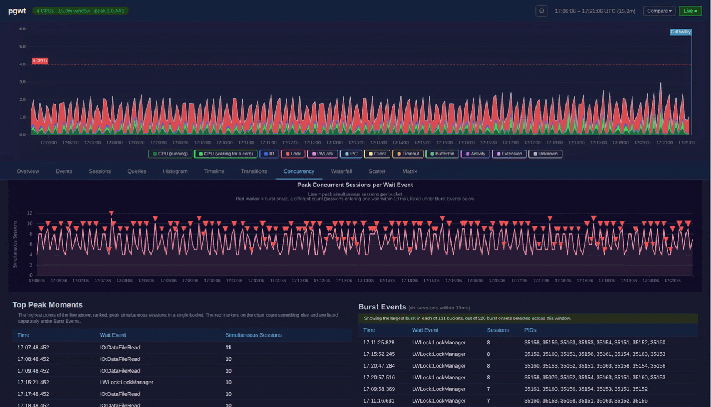

# pg_wait_tracer

> **Working on this repository after 2026-11-10?** `docs/HANDOVER_2026-11-10.md`
> is the handover: open release blockers, open PRs, the decisions left unmade,
> and where the measurement evidence lives. `docs/OPERATING_MODEL.md` describes
> how the work was run.

Real-time, **tiered** PostgreSQL wait event tracer.

pg_wait_tracer attaches to a running PostgreSQL cluster and observes wait
events across all backends. It requires no PostgreSQL patches, no extensions,
and no restarts.

It runs in **two tiers** (default `--mode tiered`):

- A continuous **sampled** tier (ASH-style, userspace reads via
  `process_vm_readv`), measured at **94.6–102.5% of no-tracer TPS retained**
  on cx33 (4 vCPU,
  AMD EPYC-Rome), PG18.6, Ubuntu 24.04 / 6.8.0-139-generic and EL8 /
  4.18.0-553.157.1.el8_10.x86_64, select-only (`-R 8000` or unthrottled)
  and TPC-B (unthrottled), 16 clients, scale 100, shared_buffers 2 GB,
  fsync off; on cx43 (8 vCPU, AMD EPYC-Rome), Ubuntu 24.04 /
  6.8.0-139-generic, PG18.6, unthrottled TPC-B, 8 clients, scale 100,
  shared_buffers 2 GB, fsync on, added PostgreSQL CPU reached **+19.2 µs/tx**;
  see the [overhead tables](#overhead).
- On-demand or anomaly-triggered **escalation** to the exact
  **hardware-watchpoint** tier, which captures every `wait_event_info`
  transition with nanosecond precision during bounded, budgeted windows.

This gives you Active Session History continuously, plus exact, every-transition
detail during escalation. Escalation is automatic on anomaly rules, including
CPU saturation, and incurs the full-mode cost while active; at saturation the
measured full mode kept about half of no-tracer throughput on the cx33 tests
[below](#overhead). The sampled CPU-share estimate can under-read under
CPU contention. The sampler now defaults to nice **-10**: in the plain-service,
shared-CPU-group setup on Ubuntu and EL8, this reduced the measured under-read
([owner's decision and measurement 7](https://github.com/DmitryNFomin/pg_wait_tracer/issues/306#issuecomment-7004963488)).
The documented sampled-tier accuracy figures apply only when the tracer and
PostgreSQL share a CPU scheduling group. **No accuracy figure is claimed when
the groups differ**; the tracer warns at startup in that setup. The existing
**±8.8 percentage point** cross-validation threshold comes from the earlier
Ubuntu ordinary-scheduling experiment; it has not been re-derived for this
default. See [Cross-validation: sampling vs exact](#cross-validation-sampling-vs-exact)
for the measured setups and the remaining residual.

Key capabilities:

- **Tiered capture** (`--mode tiered`, default): always-on userspace sampler
  + on-demand/anomaly escalation to exact hardware-watchpoint tracing; also
  available as pure `--mode sampled` or always-on exact `--mode full`
- **Escalation**: bounded, budgeted full-fidelity windows, triggered manually
  (web UI "Escalate" button / control socket) or automatically by anomaly rules
  (AAS-vs-baseline, lock-class-fraction and CPU saturation, with cooldown/hysteresis)
- **Control socket**: `{trace_dir}/pgwt.sock` JSON-line `status`/`metrics`/
  `escalate`/`deescalate`, proxied by `pgwt-server` for the web client, with
  Prometheus-ready self-observability metrics
- **Diagnostic views**: time model, events, sessions, queries, histogram,
  timeline, transition graph, concurrency, per-execution waterfall, execution
  latency scatter, and transition matrix — each tagged with its data
  fidelity (sampled / exact / mixed). Execute/plan phase probes are unavailable
  on the measured EL8 4.18 kernel (`kernel_no_ref_ctr`), so its Waterfall/Scatter
  executions are absent. Exact-only views prompt to escalate over
  sampled-only windows instead of silently showing nothing
- **Web investigation client** (`pgwt`): browser UI with ECharts AAS chart,
  color-coded drill-down tables, percentage bars, summary metrics, concurrency
  peak overlay, burst detection markers — connects to DB server over SSH
- **Live mode**: auto-refreshing AAS chart with sliding time window, per-session
  event cache for immutable trace files
- **Text dump** (`pgwt-server --dump`): quick CLI summary of trace files
  (time model, top events, top sessions, top queries) — no TUI needed
- **Advanced analysis**: wait event transitions + fingerprinting, lock chain
  detection (waiter→blocker inference), cross-session interference scoring
- **Multi-window analysis**: compare wait profiles across time horizons
  (e.g. last 5s vs 1m vs 5m)
- **Daemon mode**: persistent monitoring with automatic re-attach on
  PostgreSQL restarts
- **Trace recording**: columnar LZ4-compressed event files with hourly
  rotation and configurable retention
- **Offline replay**: analyze historical trace files without root or a
  running PostgreSQL instance
- **Dynamic event names**: auto-discovers wait event names from PostgreSQL
  (PG17+) via `pg_wait_events`, forward-compatible with PG19+

Default `tiered` mode can add substantial PostgreSQL CPU cost and reduce
throughput when it escalates. A time budget limits how long escalation lasts,
not its instantaneous cost. Below saturation, unchanged throughput can conceal
extra PostgreSQL CPU per transaction. See [Performance](#performance) for the
measurements, their hardware and workload conditions, and the escalation state.

> **Requirements — Linux only.** pg_wait_tracer relies on Linux-specific
> facilities (eBPF, `process_vm_readv`, `perf_event_open`, CPU hardware
> watchpoints) and cannot run on macOS, Windows, or \*BSD. Minimum environment:
>
> - **Linux kernel >= 5.8** with BTF enabled (`/sys/kernel/btf/vmlinux`
>   present), **or** EL8 (RHEL/Rocky/Alma/Oracle Linux 8.10, kernel 4.18 with
>   backported BTF + BPF ring buffer). EL9 (kernel 5.14) and Ubuntu are also
>   supported. The build auto-bundles a pinned libbpf/bpftool when the system
>   ones are too old (e.g. EL8's libbpf 0.5.0), so older distros build cleanly.
>   BTF is always required; on kernels without the BPF ring buffer the tool
>   degrades to sampled-only (the full tier needs ringbuf).
> - **Architecture**: x86_64 or aarch64
> - **Privileges**: root, or `CAP_BPF` + `CAP_PERFMON` + `CAP_SYS_PTRACE`
>   (older kernels: `CAP_SYS_ADMIN` + `CAP_SYS_PTRACE`)
> - **PostgreSQL**: 17 or 18 (full); 13 (supported — query attribution
>   requires `pg_stat_statements`); 14-16 not yet (see
>   [INSTALL.md](INSTALL.md))
>
> The web client (`pgwt`) and offline replay (`pg_wait_tracer --replay`,
> `pgwt-server --dump`) do not require root or Linux on the *client* side —
> only the DB server where tracing runs must meet the requirements above.

## Demo

### Tour of the web UI



A 38-second **edited tour** of all eleven tabs: Overview, Events, Sessions,
Queries, Histogram, Timeline, Transitions, Matrix, Concurrency, Waterfall and
Latency. Hard cuts between tabs, not one continuous live recording: each stop
is a short excerpt of its own recording — a chart refresh, or the table scroll
on Overview / Events / Sessions / Queries. Motion runs at 0.4–0.8x of the 25 fps
capture and the waiting in between is cut, which is how 11 tabs fit in 38
seconds. Measured over the finished loop: 15.2 s of motion, 21.7 s of holds,
longest hold 1.6 s. It is 1280x734, scaled down from the full captured frame —
nothing is cropped. The browser viewport is the project's pinned 1710x981; the
recorded video is 1710x980.

The workload is **synthetic**: pgbench plus a purpose-built lock and IO
generator. `_smoke_lock_wait`, `_smoke_row_lock_wait` and `_smoke_io_load` are
test fixtures, not anyone's schema. Every panel reads a **15-minute rolling
window**, and the wall clock differs between tabs because each tab was captured
as its own page load.

Two things in the tour can look like bugs and are not:

- **Transitions can omit the window's largest wait.** That graph thresholds
  edges by transition *count* (default: 20% of the busiest edge), so a wait made
  of a few very long events drops below the line even when it dominates by time.
  The tab says so itself — the summary under the graph names the omitted event
  and its total — and the **Show all** button puts it back.
- **Matrix looks L-shaped around `CPU*`.** Most wait transitions in this
  workload pass through running-on-CPU, so that row and column carry nearly
  everything. That is a property of what PostgreSQL does between waits, not a
  rule the view enforces: a direct wait-to-wait transition is supported and
  appears as an ordinary interior cell when it occurs.

### Recorded walkthroughs

Captured from a 60-second pgbench TPC-B workload (8 clients, scale 10) on a
tiny VM (2 vCPUs, Rocky 9 + PostgreSQL 18), with a few injected `LOCK TABLE`
statements to add lock contention. ~7M wait-event transitions captured. See
[`demos/README.md`](demos/README.md) for the recording tooling (one
`make all` reproduces both gifs below from a fresh VM).

**Web investigation client** (`pgwt`) — drag-zoom AAS chart → drill into
Events / Sessions / Queries → wait-event transition graph:
[`demos/web.gif`](demos/web.gif) (4.3 MB; not inlined, the tour above covers
the same ground).

**Text dump** (`pgwt-server --dump`) — time model + top events + top sessions
+ top queries from any trace file, no TUI required:


## Quick Start

```bash
# Build (see INSTALL.md for prerequisites)
make

# Run (auto-discovers single PG instance, must be root).
# Default "tiered": sampling plus manual or automatic anomaly escalation.
# Escalation incurs full-mode cost while active; see Performance below.
sudo ./pg_wait_tracer

# Force continuous exact watchpoint tracing; assess its measured cost below.
sudo ./pg_wait_tracer --mode full

# One-shot: collect one 10-second interval and exit
sudo ./pg_wait_tracer --mode full --count 1 --interval 10

# Multi-window: compare wait profiles across time horizons
sudo ./pg_wait_tracer --window 5s,1m,5m

# Daemon mode: persistent monitoring with trace recording
sudo ./pg_wait_tracer --daemon -T /var/lib/pgwt/traces

# Offline replay: analyze last hour from trace files (no root needed)
pg_wait_tracer --replay -T /var/lib/pgwt/traces --from 1h

# Web client: browser UI from your laptop over SSH (no root needed)
pgwt root@db-server

# Quick summary from trace files (no root needed)
pgwt-server --dump /var/lib/pgwt/traces
```

## Capture Tiers (`--mode`)

Orthogonal to the run modes below, `--mode` selects *how* wait events are
captured. The default is **`tiered`**.

| Mode | Fidelity | PG overhead | What it does |
|------|----------|-------------|--------------|
| `tiered` *(default)* | sampled, escalates to exact | Sampled cost between windows; full-mode cost during escalation ([measurements](#overhead)) | Continuous userspace sampler (`process_vm_readv`); escalates for bounded, budgeted windows on demand or automatically on anomaly, including CPU saturation. |
| `sampled` | sampled | 94.6–102.5% of no-tracer TPS retained; up to +19.2 µs/tx PostgreSQL CPU (conditions immediately below) | Userspace ASH-style sampling at a fixed rate. No watchpoints, never escalates. |
| `full` | exact wait transitions; other evidence depends on probes | Substantial CPU cost and throughput loss in these tests ([measurements](#overhead)) | Continuous hardware watchpoints capture `wait_event_info` transitions. Query/command attribution and execution phases also need exact uprobes; see [flag trade-offs](#performance-tuning-flags). |
| `coop` | exact | — | Cooperative (PostgreSQL extension) tier — **stub only**: the interface is frozen but the provider advertises itself and then returns "not available in this build". The real implementation ships in the separate PG-extension track. |

Sampled measurements: **94.6–102.5% of no-tracer TPS retained** on cx33 (4 vCPU,
  AMD EPYC-Rome), PG18.6, Ubuntu 24.04 / 6.8.0-139-generic and EL8 /
  4.18.0-553.157.1.el8_10.x86_64, select-only (`-R 8000` or unthrottled)
  and TPC-B (unthrottled), 16 clients, scale 100, shared_buffers 2 GB,
  fsync off; on cx43 (8 vCPU, AMD EPYC-Rome), Ubuntu 24.04 /
  6.8.0-139-generic, PG18.6, unthrottled TPC-B, 8 clients, scale 100,
  shared_buffers 2 GB, fsync on, added PostgreSQL CPU reached **+19.2 µs/tx**. See [Overhead](#overhead) for each arm.

```bash
# Default — continuous sampling, with manual or automatic escalation
sudo ./pg_wait_tracer --daemon -T /var/lib/pgwt/traces

# Force exact watchpoint tracing for a focused investigation
sudo ./pg_wait_tracer --mode full --count 1

# Pure sampling at 50 Hz
sudo ./pg_wait_tracer --mode sampled --sample-rate 50
```

In `tiered` mode, EXACT-required views (histogram, transitions, fingerprints,
lock chains, interference, concurrency, executions/waterfall, execution
scatter, and transition matrix) report `requires full-fidelity data`
over windows with no escalation, rather than returning silently empty results
— the web client renders an explicit "escalate to capture" state. Execution
Waterfall and Scatter also need execute/plan phase probes: on the measured
EL8 4.18 kernel these never attach in any mode (`kernel_no_ref_ctr`), so
escalation cannot supply those executions there. See the
[probe limitations](#performance-tuning-flags).

### Escalation

A full-fidelity window can be opened two ways:

- **Manually** — the web UI's "Escalate" button, or the control socket
  (`{"cmd":"escalate","duration_s":N}`). `{"cmd":"deescalate"}` closes it early.
- **Automatically** — anomaly rules evaluated on the sampled stream:
  AAS exceeding a multiple of its rolling baseline (`--anomaly-aas-factor`,
  default 3.0× sustained `--anomaly-aas-ticks` ticks, default 3), or the
  Lock-class share of active samples exceeding `--anomaly-lock-fraction`
  (default 0.30) **and** the absolute Lock-class AAS exceeding
  `--anomaly-lock-min-aas` (default 2.0). The lock floor stops a single
  backend's routine row-lock wait — a lock-fraction of 1.0 over an AAS of 1 —
  from burning a whole window on OLTP noise; a genuine lock convoy still fires.
  Independently, a CPU-demand CUSUM detects sustained demand near the target
  postmaster's effective CPU capacity:
  `S=max(0,S+dt*(min(cpu_AAS/C,cap)-(k+margin)))` fires at `S>=h` only when
  `cpu_AAS>=cpu_min_aas` (defaults `k=0.80`, affinity-only `margin=0.02`,
  `cpu_min_aas=2.0`, `h=1.50`, `cap=1.25`). Quota and explicit override
  capacities use zero margin. `dt` is the nominal sample period, so a delayed
  tick cannot fabricate evidence. Failed read coverage and unknown capacity
  never advance it; a material capacity change or return from a partial-read
  gap resets it. Each continuous saturation episode fires once, then re-arms
  only after a complete, capacity-known tick falls below `k`. CPU fires have
  the distinct `cpu_saturation` escalation reason and use the same window,
  cooldown, and budget path. If discovered capacity is known to be uncertain,
  set the deployment's known value with `--anomaly-cpu-capacity`.
  A cooldown (`--anomaly-cooldown-s`, default 120) prevents flapping.

The rolling AAS baseline is **frozen while a metric is anomalous** so a
sustained incident cannot silently raise the bar and silence the rule. To keep
a *legitimate* load regime change from re-firing forever, the baseline resumes
learning — at 1/10 the normal EWMA rate — only after the metric has stayed
continuously over the threshold for **15 minutes** (the "slow learn-through"):
short incidents never move the bar, a real new normal is eventually adopted.

Every window is bounded: per-window length is set by the request (or
`--anomaly-window-s`, default 60, for auto-triggers), and total escalation time
is capped by `--escalation-budget` per rolling hour:

- **`300`** *(default)* — 300 full-fidelity seconds per rolling hour. A request
  larger than the remaining budget is **clamped** to what's left (the window
  runs up to the cap), and mid-window enforcement closes a window the instant
  cumulative consumption reaches the budget, so worst-case full-fidelity time
  per hour never exceeds the budget even under adversarial repeated extensions.
- **`0`** — escalation **disabled** (every escalate request is denied). The
  self-metrics honestly report `0` budget remaining.
- **`unlimited`** — no cap (the old `0` behavior). Reported as
  `escalation_budget_unlimited: true`.

When the budget is exhausted, further escalations are denied (and counted in the
self-metrics). Note the duty-cycle floor: the cooldown is measured from the
*start* of each auto-escalation, so a sustained incident re-fires every
`--anomaly-cooldown-s` (default 120s) for a `--anomaly-window-s` (default 60s)
window — a **50% full-fidelity duty cycle** on a persistent incident, and still
bounded above by the budget (which will curtail it sooner). Widen the cooldown
or shrink the window to lower the duty cycle; the sampled tier keeps full
coverage throughout regardless. On very high backend counts the synchronous
watchpoint `attach_all` at escalation start can briefly stall the sampler; the
lost ticks are weight-compensated (each tick is billed by measured elapsed
time), so the accounting stays correct — only time resolution dips for that
instant.

```bash
# Open a 120s full-fidelity window on a running daemon via the control socket
echo '{"cmd":"escalate","duration_s":120}' | nc -U /var/lib/pgwt/traces/pgwt.sock

# Inspect current tier / budget
echo '{"cmd":"status"}'  | nc -U /var/lib/pgwt/traces/pgwt.sock
echo '{"cmd":"metrics"}' | nc -U /var/lib/pgwt/traces/pgwt.sock
```

## Control Socket

When recording is enabled (`--trace-dir`), the daemon listens on a unix-domain
socket at `{trace_dir}/pgwt.sock` (mode 0600). It speaks a newline-delimited
JSON protocol — one request object per line, one response object per line.
`pgwt-server` proxies it through to the web client as a single `control`
command, so the browser UI drives escalation and reads self-metrics without a
direct connection.

| Command | Request | Response (summary) |
|---------|---------|--------------------|
| `status` | `{"cmd":"status"}` | `mode`, `tier` (`sampled`/`escalated`), `escalation_supported`, `escalation_seconds_remaining`, `escalation_budget_remaining_s`, `escalation_reason`, `uptime_s`, `backends`, `pg_pid`, `version`, PG13 `sampled_attr_pg13_route` (`computed`/`scan`) |
| `metrics` | `{"cmd":"metrics"}` | self-observability counters (below) |
| `escalate` | `{"cmd":"escalate","duration_s":N}` | `escalated`, `granted_s`, `seconds_remaining`, `budget_remaining_s` — or `ok:false` + `error` + `budget_remaining_s` when over budget / not tiered |
| `deescalate` | `{"cmd":"deescalate"}` | closes the window now (idempotent); errors if not `--mode tiered` |

**Self-observability metrics** (`metrics` command — Prometheus-ready names):

- `events_total`, `events_per_sec`, `lifecycle_events_total`
- `samples_total`, `samples_per_sec`, `sample_read_faults_total`
- `sampled_attr_tick_read_failures_total`: failed at-tick status reads, including
  rows that have not initialised yet
- `sampled_attr_pg13_scan_fallbacks_total`: PG13 candidate-scan attempts when
  the computed route is unavailable; each use is counted
- `wp_attach_failures_total`, `ringbuf_drops_total`, `backends_tracked`
- `exact_preseed_unpublished_total`: successful PG14–17 no-command proofs
  from an untorn PID-zero own status slot in the validated shared mapping and
  struct stride, with unchanged pinned process identity and a shared wait address
- `exact_preseed_wait_addr_refreshed_total`: successful UNPUBLISHED proof seeds
  whose missing or non-shared cached wait address was resolved once during
  preseed, validated as shared under the process identity pin, then saved for
  watchpoint attachment (PG14–17 only)
- `exact_preseed_reread_total`: one-shot coherent attribution rereads after the
  fallback sees an own-pid, context-bearing row, command closed or already open
  (PG14+); failed rereads still deny escalation.
- `exact_preseed_torn_exhausted_total`: escalation rollbacks because a
  backend's status row stayed torn (change counter odd or changing) through the
  preseed's paced re-reads (at most 8 pauses of 0.5 ms per escalation attempt).
  These counters also appear in `status`.
- `trace_events_written_total`, `trace_bytes_written_total`
- `tier`, `escalation_active`, `escalation_seconds_remaining`,
  `escalation_budget_remaining_s`, `escalation_windows_total`,
  `escalation_denied_total`
- `anomaly_fires_total`, `anomaly_near_total`, `anomaly_dropped_budget_total`,
  `anomaly_dropped_cooldown_total`, `anomaly_baseline_aas`

`wp_attach_exit_race_total` counts failed watchpoint operations only when errno
is ESRCH and the pinned original task is gone, Z/X, or has both PF_EXITING and
zero vsize. PF_EXITING proof is logged as `liveness=exiting` in
`WP-ATTACH-FAIL` (`exit_proof=1` for gone/Z/X, `2` for PF_EXITING).
ESRCH alone remains `wp_attach_failures_total`. Other errnos
remain failures even when the target has gone. The liveness subsets are
`wp_attach_failures_live_total`, `wp_attach_failures_gone_total`
and `wp_attach_failures_unknown_total`. Gone targets with a non-ESRCH errno
remain real failures in the gone subset.

In watchpoint capture, `lifecycle_exit_before_attach_total` counts retirements
without a completed real attachment or retained INIT evidence. It excludes
watchpoint failures already counted in `wp_attach_failures_total`, counted
enrollment refusals (including those without a registry entry), and counted
live FORK conflicts with a retained exit-race entry. Each backend has one
failure or retirement class. Its three once-per-retirement classes are:

- `lifecycle_exit_before_attach_with_opportunity_total`: missed attachment,
  opportunity observed (gated): a registry entry exists, bootstrap was armed,
  and the post-arm check ran.
- `lifecycle_exit_before_attach_unknown_total`: opportunity unknown (gated):
  the required entry/armed/post-arm evidence is incomplete and there is no
  positive first-handling exclusion. Bootstrap-open, startup-scan and direct
  attach exit races without that evidence belong here.
- `lifecycle_exit_before_attach_no_opportunity_total`: exited before the tracer
  could attach (reported): no registry entry because first handling positively
  found the target gone. Bounded refusal bookkeeping overflow denies this
  exclusion; a PID without retained evidence of a counted failure stays unknown.

Each counted PID emits `EXIT-BEFORE-ATTACH` with the class, entry/armed status,
post-arm pointer, shared-address result and errnos, plus global no-state and
wait-read counter deltas since enrollment (availability is explicit). These
are diagnostic deltas, not per-PID attribution. No INIT timestamp or duration
is invented. Retained INIT evidence keeps the existing INIT rule and counters.
An exit proof supplies the `wp_attach_exit_race_total` reason; it never proves
unavoidable loss or no opportunity. That reason may coexist with an INIT-loss
class or a retirement class. `wp_attach_failures_total`, observed-opportunity
retirements and unknown-opportunity retirements gate `DAEMON_INTEGRITY_COUNTERS`.
The no-opportunity retirement class is reported. A live FORK conflicting with
a retained startup exit-race entry is conservatively counted as an enrollment
failure, including possible PID reuse; a proven exit is not retried.

## Operating Modes

pg_wait_tracer has three operating modes:

### Interactive (default)

Attaches to PostgreSQL, displays live views, and exits when interrupted or
when `--count`/`--duration` is reached. This is the original mode — useful
for quick investigations.

```bash
sudo ./pg_wait_tracer --view system_event --count 3
```

### Daemon (`--daemon`)

Runs persistently. When PostgreSQL restarts (crash, upgrade, `pg_ctl restart`),
the daemon detects the terminated postmaster, waits for a new one to appear,
and re-attaches automatically. BPF programs are destroyed and reloaded on each
cycle because BPF rodata is immutable after load.

Cannot be combined with `--count` or `--duration`.

```bash
# Daemon with trace recording and 48-hour retention
sudo ./pg_wait_tracer --daemon -T /var/lib/pgwt/traces -R 48

# Daemon with live output to terminal
sudo ./pg_wait_tracer --daemon --view active
```

**How restart detection works:**

1. Every interval tick, the daemon calls `kill(postmaster_pid, 0)` to check
   if the postmaster is alive.
2. When the postmaster dies, the daemon prints a message and enters a wait
   loop, checking for a new PostgreSQL instance every 5 seconds.
3. PGDATA is inferred from `/proc/<pid>/cwd` at startup (or provided via
   `--pgdata`). On restart, the daemon reads the new `postmaster.pid` from
   PGDATA to discover the new PID.
4. On re-attach, all BPF state is reset — accumulators start fresh.

### Replay (`--replay`)

Reads completed trace files and produces the same views as live mode, but
from historical data. Does not require root or a running PostgreSQL instance.

```bash
# Replay last hour, time_model view
pg_wait_tracer --replay -T /var/lib/pgwt/traces --from 1h

# Replay specific time range
pg_wait_tracer --replay -T /var/lib/pgwt/traces \
    --from "2025-02-25T14:00:00" --to "2025-02-25T14:30:00" \
    --view system_event

# Replay with multi-window
pg_wait_tracer --replay -T /var/lib/pgwt/traces --from 2h \
    --view query_event --window 5s,1m,5m
```

**Limitations:**

- The `active` view is not available in replay mode (it requires the live
  BPF state_map to read current wait states).
- `current.trace` (the file being written by the daemon) has no footer and
  cannot be read by replay. Only rotated `.trace.lz4` files are readable.
  Only rotated `.trace.lz4` files are readable by replay and `pgwt-server`.
- Output format is always `text` in replay mode.

### Web Investigation Client (`pgwt`)

A browser-based investigation tool that connects to a remote DB server over SSH.
No database credentials needed — it reads trace files directly on the server.

```bash
# From your laptop — opens browser automatically
pgwt root@db-server

# Custom trace directory and server binary path
pgwt --trace-dir /var/lib/pgwt/traces \
     --server-path /usr/local/bin/pgwt-server \
     root@db-server
```

**Architecture:**

```
[Your laptop]                        [DB server]
pgwt (Go binary)                     pgwt-server (C binary)
  ├─ spawns: ssh user@host             ├─ reads trace files
  │    pgwt-server <trace-dir>         ├─ computes aggregates
  ├─ localhost:8384 HTTP server        └─ JSON lines on stdin/stdout
  └─ browser UI (ECharts)
```

**Features:**

- **AAS stacked area chart** (ECharts) — 11 wait class colors, interactive
  zoom with drag-to-select, tooltip with per-class AAS breakdown and percentages.
  **Fidelity shading**: sampled-only spans are washed amber and mixed spans
  indigo, so you can see at a glance which parts of the window are estimated vs
  exact; escalation windows are annotated (cyan for manual, red for anomaly).
- **Escalate control** — an "Escalate" button in the header opens a
  full-fidelity window (and shows the seconds left / a "Stop" button while one
  is open), plus a budget readout of full-fidelity seconds remaining this hour.
- **Daemon self-metrics panel** — live tier, events/s, samples/s, ringbuf
  drops, sample faults, estimated overhead, anomaly counters, baseline AAS, and
  remaining escalation budget (read over the control socket).
- **4 table views**: Overview (time model), Events, Sessions, Queries
- **Drill-down navigation**: click a wait class → see its events → click an
  event → see sessions → click a session → see queries. Breadcrumb trail
  with colored dots shows filter stack with click-to-go-back.
- **Color-coded dots**: wait class colors shown next to event/class names
  in all 4 tables
- **Percentage bars**: visual bar fills behind `%DB`, `CPU%`, `Wait%` columns,
  colored by wait class
- **Summary metrics**: DB Time, Wall clock, AAS, Idle time, CPUs shown
  above the overview table
- **Sortable columns**: click any column header to sort ascending/descending
- **Auto-reconnect**: WebSocket reconnects with exponential backoff on
  connection loss
- **Zero config**: auto-discovers trace files, auto-opens browser

**Prerequisites on DB server:** `pgwt-server` binary and trace files from the
daemon. See [INSTALL.md](INSTALL.md) for build instructions.

**Flags:**

| Flag | Default | Description |
|------|---------|-------------|
| `--port` | 8384 | Local HTTP port |
| `--trace-dir` | `/var/lib/pgsql/18/data/pg_wait_tracer/` | Trace directory on the remote host |
| `--server-path` | `pgwt-server` | Path to `pgwt-server` binary on the remote host |

### Text Dump (`pgwt-server --dump`)

Quick CLI summary of trace files — time model, top events, top sessions, top
queries. No TUI, no browser, no root. Useful for SSH one-liners.

```bash
# Summary of all trace files
pgwt-server --dump /var/lib/pgwt/traces

# Pipe-friendly (combine with standard tools)
pgwt-server --dump /var/lib/pgwt/traces | grep "IO:"
```

See [INSTALL.md](INSTALL.md) for build instructions and
[docs/ROADMAP_AND_STATUS.md](docs/ROADMAP_AND_STATUS.md) for the development roadmap.

**Planned features** (see roadmap for details):
- Query text capture from `st_activity` in shared memory
- Plan identifier capture (`st_plan_id`, PG18+) for plan regression detection
- Live mode (connect web client to running daemon for real-time streaming)

## CLI Reference

### Target Selection

| Flag | Short | Default | Description |
|------|-------|---------|-------------|
| `--pid <PID>` | `-p` | auto-detect | Postmaster PID |
| `--pgdata <DIR>` | `-D` | auto-detect | PGDATA directory (reads postmaster.pid) |

**Auto-discovery:** When neither `--pid` nor `--pgdata` is given, pg_wait_tracer
scans `/proc` for running PostgreSQL instances. If exactly one is found, it
attaches automatically. If multiple are found, it lists them and exits.

### Output Control

| Flag | Short | Default | Description |
|------|-------|---------|-------------|
| `--view <VIEW>` | `-V` | `time_model` | Output view (see Views section) |
| `--sort <MODE>` | `-S` | `wait_time` | Sort for active view: `wait_time`, `db_time`, `pid`, `event` |
| `--format <FMT>` | `-f` | auto-detect | Output format: `tui` (terminal), `text` (pipe) |
| `--interval <SEC>` | `-i` | 5 | Refresh interval in seconds (minimum 1) |
| `--duration <SEC>` | `-d` | unlimited | Stop after N seconds |
| `--count <N>` | `-n` | unlimited | Print N intervals then exit |
| `--window <W1,W2,W3>` | `-w` | — | Time windows, e.g. `5s,1m,5m` (first must equal interval) |

**Format auto-detect:** When stdout is a terminal, output uses TUI mode (screen
clearing). When piped or redirected, output switches to text mode (timestamps
per interval, no screen clearing).

### Filters

| Flag | Short | Default | Description |
|------|-------|---------|-------------|
| `--event <NAME>` | `-e` | — | Event filter (required for histogram; optional for query_event) |
| `--pid-filter <PID>` | `-P` | — | Per-event detail for one backend (session_event view) |
| `--query-id <ID>` | `-Q` | — | Filter query_event to one query |

### Trace Recording

| Flag | Short | Default | Description |
|------|-------|---------|-------------|
| `--trace-dir <DIR>` | `-T` | disabled | Directory for trace files (enables recording) |
| `--trace-retention <H>` | `-R` | 24 | Keep trace files for H hours |
| `--retention-gb <G>` | — | off | Target total trace-dir size of G GiB (fractional allowed); oldest eligible archives deleted first. Live files and `.jsonl` sidecars are protected; pending summaries or cleanup failures can leave usage over cap |
| `--trace-group <GROUP>` | — | `dba` if that group exists, else the group PostgreSQL runs under | Unix group allowed to read trace files. The default is resolved against this host, so traces are readable by the PostgreSQL service account rather than root-only when no `dba` group was created. A group named explicitly is never substituted: if it does not exist the daemon warns and the traces stay root-only |

### Replay

| Flag | Short | Default | Description |
|------|-------|---------|-------------|
| `--replay` | — | off | Replay mode (read trace files instead of live tracing) |
| `--from <TIME>` | — | start of files | Start time for replay |
| `--to <TIME>` | — | end of files | End time for replay |

**Time formats for `--from`/`--to`:**

- ISO 8601: `2025-02-25T14:30:00` or `2025-02-25 14:30:00`
- Relative: `1h`, `30m`, `90s`, `2h30m` (that much time ago from now)
- Special: `now`

### Daemon

| Flag | Short | Default | Description |
|------|-------|---------|-------------|
| `--daemon` | — | off | Persistent mode with PostgreSQL restart detection |

### Capture Tier

| Flag | Short | Default | Description |
|------|-------|---------|-------------|
| `--mode <MODE>` | — | `tiered` | Capture tier: `tiered` (continuous sampler + manual/anomaly escalation, including CPU saturation), `sampled`, `full` (exact watchpoints), `coop` (stub). See [Capture Tiers](#capture-tiers---mode) |
| `--sample-rate <HZ>` | — | `10` | Sampling rate for `sampled`/`tiered` (1-1000 Hz) |
| `--escalation-budget <S>` | — | `300` | `tiered`: full-fidelity seconds allowed per rolling hour. `0` = escalation **disabled** (deny all); `unlimited` = no cap. Over-budget requests are clamped to the remainder; enforced mid-window. |

### Anomaly Triggers (tiered mode)

Auto-escalation rules evaluated on the sampled stream. Ignored outside
`--mode tiered`.

| Flag | Short | Default | Description |
|------|-------|---------|-------------|
| `--anomaly-aas-factor <K>` | — | `3.0` | Fire when AAS > K × rolling baseline |
| `--anomaly-aas-ticks <N>` | — | `3` | ...sustained for N consecutive ticks |
| `--anomaly-lock-fraction <F>` | — | `0.30` | Fire when Lock-class share of active samples > F (sustained N ticks) |
| `--anomaly-lock-min-aas <A>` | — | `2.0` | ...**and** absolute Lock-class AAS ≥ A (min-activity floor: a lone lock waiter can't escalate) |
| `--anomaly-cooldown-s <S>` | — | `120` | Minimum seconds between auto-escalations |
| `--anomaly-window-s <S>` | — | `60` | Full-fidelity window length per auto-trigger |
| `--anomaly-cpu-capacity <C>` | — | discovered | Override target effective logical CPU capacity; use when discovery is known to misrepresent backend capacity |
| `--anomaly-cpu-min-aas <A>` | — | `2.0` | Absolute CPU-class AAS required for a CPU CUSUM fire |
| `--anomaly-cpu-margin <M>` | — | `0.02` | Extra utilization slack for affinity-only capacity; quota and override capacity use zero margin |
| `--anomaly-cpu-cusum-k <K>` | — | `0.80` | CPU-demand CUSUM slack/reference utilization |
| `--anomaly-cpu-cusum-h <H>` | — | `1.50` | CPU-demand CUSUM fire threshold |
| `--anomaly-cpu-cusum-cap <U>` | — | `1.25` | Cap `cpu_AAS / effective_capacity` per tick |
| `--anomaly-cpu-coverage-gap-s <S>` | — | `2.0` | Consecutive blind duration before held CPU evidence is discarded; converted to ticks using `--sample-rate` |
| `--anomaly-cpu-cusum-disable` | — | off | Disable only the CPU saturation guard |

For compatibility with existing pure-sampled and manual-window deployments,
`--anomaly-aas-factor 1000000` (or larger) disables both the multiplicative AAS
rule and the CPU saturation guard. The lock rule retains its own configuration.

### Performance Tuning

| Flag | Short | Default | Description |
|------|-------|---------|-------------|
| `--skip-usdt` | — | off | In `--mode full`, disables every exact uprobe, leaving hardware watchpoints. Loses execution phases, command/query edges and first-occurrence query text; query and command-scoped numbers can be wrong. See [measured recoveries and trade-offs](#performance-tuning-flags). |
| `--lightweight` | — | off | In `--mode full`, disables every exact uprobe and drops the event ring buffer. Only time_model/system_event accumulators remain; no session/query/histogram views or event trace recording. Command-scoped numbers can be wrong; see [measured recoveries and trade-offs](#performance-tuning-flags). |
| `--skip-query-id` | — | off | Disables CLI query_event and first-occurrence query-text capture; does not remove the exact uprobes. The measured throughput change was small and sometimes negative; see [results](#overhead). |

Execute/plan phase data is already unavailable in every mode on the measured
EL8 4.18 kernel (`kernel_no_ref_ctr`), even without these flags.

### Other

| Flag | Short | Default | Description |
|------|-------|---------|-------------|
| `--verbose` | `-v` | off | Print diagnostic info to stderr |
| `--help` | `-h` | — | Show usage |

## Views

### time_model (default)

System-wide time accounting with event hierarchy. Shows how backends spend their
time, broken down by CPU and each wait class, with the top individual events
shown as indented subcategories under each class. This is the starting point
for any investigation.

**Columns:**

| Column | Description |
|--------|-------------|
| Stat Name | Time category (class or individual event) |
| Time (ms) | Duration in the interval |
| % DB Time | Fraction of total DB Time |

**Event hierarchy:** Each wait class shows the top 3 individual events that
contribute >= 1% of DB Time, indented beneath the class total. CPU has no
sub-events (it is not a wait class). Classes with 0 time are hidden.

**Example:**

```
════════════════════════════════════════════════════════════════════════════════
pg_wait_tracer — Time Model    Backends: 12    Interval: 5s
════════════════════════════════════════════════════════════════════════════════

  Stat Name                           Time (ms) % DB Time
  ────────────────────────────────────────────────────────────────────────────
  DB Time                            25088.6     100.0%
    CPU*                              5498.6      21.9%
    IO                                3262.8      13.0%
      IO:DataFileRead                 2534.1      10.1%
      IO:DataFileWrite                 312.4       1.2%
    Lock                              2104.3       8.4%
      Lock:Transaction                1980.1       7.9%
    LWLock                            1823.2       7.3%
      LWLock:WALInsert                1312.3       5.2%
      LWLock:BufferContent             410.8       1.6%
    Timeout                            450.0       1.8%

  (Activity/Idle — excluded from DB Time)    13442.5       —
```

`Client:ClientRead` (a backend waiting for the next query from the client) is
treated as **idle** — like Oracle's "SQL\*Net message from client" — so it is
excluded from DB Time. It still shows up in event lists, but with `—` in the
`% DB` column; only the Activity class is hidden entirely.

**Reading this output:**

- **DB Time** is the total non-idle time across all backends. With 12 backends
  over a 5-second interval, the maximum is 60,000 ms (12 x 5000).
- **CPU\*** means time when no PostgreSQL wait event was set. This is mostly
  CPU execution, but may include uninstrumented code paths. The asterisk
  indicates it is an approximation.
- **IO at 13.0%** — and you can immediately see that **DataFileRead at 10.1%**
  is the dominant IO event. No need to switch to `system_event` view.
- **Lock at 8.4%** — the sub-event shows it's almost entirely Transaction
  locks (7.9%), meaning queries are blocked by other uncommitted transactions.
- Small events below 1% of DB Time are hidden to avoid clutter. Use
  `system_event` view for the full event list.
- **Activity/Idle** is shown separately and excluded from DB Time. Idle backends
  contribute nothing to DB Time.

#### Multi-window mode

With `--window`, the time_model view shows side-by-side columns — one per window —
so you can see how wait profiles change across time horizons:

```bash
sudo ./pg_wait_tracer --window 5s,1m,5m
```

```
════════════════════════════════════════════════════════════════════════════════
pg_wait_tracer — Time Model    Backends: 12    Interval: 5s
════════════════════════════════════════════════════════════════════════════════

  Stat Name                         Last 5s    % DB   Last 1m    % DB   Last 5m    % DB
  -------------------------------- --------- ------- --------- ------- --------- -------
  DB Time                            5088.6  100.0%   62340.1  100.0%  312450.8  100.0%
    CPU*                             1498.6   29.4%   13712.3   22.0%   72312.1   23.1%
    IO                                862.3   16.9%   12340.5   19.8%   98234.2   31.4%
      IO:DataFileRead                 621.2   12.2%    9823.1   15.8%   82123.4   26.3%
      IO:DataFileWrite                198.4    3.9%    2012.3    3.2%   12345.6    4.0%
    LWLock                            423.1    8.3%    4923.4    7.9%   21234.5    6.8%
      LWLock:WALInsert                312.3    6.1%    3812.1    6.1%   16234.2    5.2%

  (Activity/Idle)                   12560.4       -   62340.1       -  312450.8       -
```

**Reading this output:**

- Each column shows the delta for that time window. "Last 5s" is the most recent
  5 seconds, "Last 5m" covers the last 5 minutes.
- Compare columns to spot trends: IO rising from 16.9% (5s) to 31.4% (5m) means
  IO has been decreasing recently — the system is improving.
- **Progressive population:** On startup, shorter windows fill first. Longer windows
  show `-` until enough history accumulates (e.g., "Last 5m" needs 5 minutes of data).
- The first window must equal the `--interval` value. Windows must be increasing.
- Without `--window`, the default single-column cumulative view is shown (see above).

---

### system_event

Top wait events across all backends, ranked by total duration. Use this to
identify which specific events consume the most time.

**Columns:**

| Column | Description |
|--------|-------------|
| Wait Event | Event name as `Class:Event` (e.g. `IO:DataFileRead`), or the derived rows `CPU*` and `Off-CPU*` |
| Total Waits | Number of occurrences (— for `Off-CPU*`, which is a residual duration, not a countable event) |
| Total (ms) | Cumulative duration |
| Avg (us) | Average duration per occurrence (— for `Off-CPU*`) |
| Max (us) | Longest single occurrence (— for `Off-CPU*`) |
| % DB | Fraction of DB Time |

`Off-CPU*` (#498) is `CPU*`'s measured sibling: the part of an on-CPU
interval's wall clock the backend was not actually on a CPU for (runqueue,
cgroup throttling, unaccounted). With it, `CPU* + Off-CPU* + Σ waits` is the
whole of DB Time, so this view's `% DB` column adds up exactly as
`time_model`'s does. It is absent in the legacy/sampled shape, where the
residual is structurally zero, and it does not count against the view's
20-row cap.

**Example:**

```
════════════════════════════════════════════════════════════════════════════════
pg_wait_tracer — System Events (cumulative)    Backends: 12
════════════════════════════════════════════════════════════════════════════════

  Wait Event                 Total Waits     Total (ms)   Avg (us)     Max (us)    % DB
  ────────────────────────────────────────────────────────────────────────────────────────
  CPU*                          43460        5498.6      126.5     10630.2   21.9%
  IO:DataFileRead                8234        3262.8      396.2     45623.1   13.0%
  Off-CPU*                          —        2890.4          —            —   11.5%
  Lock:Transaction                567        2104.3     3712.2    892100.5    8.4%
  LWLock:WALInsert               4812        1823.2      378.9      8934.2    7.3%
  Client:ClientRead              1203         882.1      733.1     25410.3      —
  Timeout:PgSleep                   3         450.0   150000.0    200012.1    1.8%
  IO:DataFileWrite               1056         312.4      295.8      5612.0    1.2%
  LWLock:BufferContent            892         198.7      222.8      3451.0    0.8%
```

**Reading this output:**

- Events are sorted by `Total (ms)`, so the top rows are the biggest bottlenecks.
- **High Avg with low count** (like `Lock:Transaction`) means long individual waits
  — a few queries are blocking.
- **Low Avg with high count** (like `LWLock:WALInsert`) means frequent short waits
  — high concurrency on the WAL.
- **Large Max vs Avg gap** suggests outlier events. Use `histogram` view to see
  the full distribution.

#### Multi-window mode

With `--window`, the system_event view shows vertically stacked sections — one per
window — so you can see how the top events change across time horizons:

```bash
sudo ./pg_wait_tracer --view system_event --window 5s,1m,5m
```

```
════════════════════════════════════════════════════════════════════════════════
pg_wait_tracer — System Events    Backends: 12    Interval: 5s
════════════════════════════════════════════════════════════════════════════════

---- Last 5s -----------------------------------------------------------------
  Wait Event                  Total Waits     Total (ms)   Avg (us)      % DB
  -------------------------- ------------ -------------- ---------- ---------
  CPU*                           4346        549.9      126.5     21.9%
  IO:DataFileRead                 823        326.3      396.2     13.0%
  Lock:transactionid               57        210.4     3712.2      8.4%
  ...

---- Last 1m -----------------------------------------------------------------
  Wait Event                  Total Waits     Total (ms)   Avg (us)      % DB
  -------------------------- ------------ -------------- ---------- ---------
  CPU*                          52143       6598.7      126.5     22.0%
  IO:DataFileRead                9882       3915.4      396.2     13.0%
  ...

---- Last 5m -----------------------------------------------------------------
  (waiting for data)
```

**Reading this output:**

- Each section shows the delta for that time window. Events are sorted by total
  duration within each section, so the ranking can differ between windows.
- **Max (us) is not shown** in multi-window mode because delta snapshots track
  cumulative count and total — not per-window maximums. Avg (us) is still valid.
- Shorter windows fill first. Longer windows show "(waiting for data)" until enough
  history accumulates.
- Without `--window`, the default single-column cumulative view is shown (see above),
  which includes the Max (us) column.

---

### session_event

Per-backend summary. Shows each backend's DB Time, CPU/Wait ratio, and top
wait event. Use `--pid-filter` to drill into a specific backend.

**Columns (summary):**

| Column | Description |
|--------|-------------|
| PID | Backend process ID |
| Type | Backend type (client, bgwriter, checkpointer, walwriter, etc.) |
| User | Connected user (or `-`) |
| DB | Database (or `-`) |
| DB Time(ms) | Non-idle time for this backend |
| CPU% | Time spent on CPU |
| Wait% | Time spent waiting |
| Top Wait | Highest-duration wait event |

**Example:**

```
════════════════════════════════════════════════════════════════════════════════
pg_wait_tracer — Session Summary    Backends: 12
════════════════════════════════════════════════════════════════════════════════

  PID     Type           User       DB         DB Time(ms)  CPU% Wait%  Top Wait
  ──────────────────────────────────────────────────────────────────────────────────
  12345   client         app        mydb          4096.2  42.1% 57.9%  IO:DataFileRead
  12346   client         app        mydb          3820.5  38.4% 61.6%  Lock:Transaction
  12347   client         admin      mydb          1024.0  71.2% 28.8%  LWLock:WALInsert
  12400   bgwriter       -          -              512.3  62.1% 37.9%  IO:DataFileWrite
  12401   checkpointer   -          -              256.1  15.3% 84.7%  IO:DataFileSync
  12402   walwriter      -          -              128.0  44.2% 55.8%  IO:WALWrite
```

**With `--pid-filter 12345`**, an additional detail table appears below the
summary, showing the full event breakdown for that backend (same columns as
system_event).

**Reading this output:**

- **CPU% + Wait% = 100%** for each backend's active time.
- A backend with high Wait% and `Lock:Transaction` as top wait is blocked by
  another transaction — check for long-running queries or deadlocks.
- System processes (bgwriter, checkpointer, walwriter) normally show IO waits.

---

### active

A "top-like" view of currently active backends, showing each backend's current
state, wait event, and cumulative DB Time. This is the first view a DBA opens to
see what's happening right now.

```bash
sudo ./pg_wait_tracer --view active
sudo ./pg_wait_tracer --view active --sort db_time
```

**Columns:**

| Column | Description |
|--------|-------------|
| PID | Backend OS process ID |
| State | `on cpu`, `waiting`, or `idle` (from BPF tracing state) |
| Wait Event | Current wait event name (if waiting), `—` otherwise |
| Wait (ms) | Duration in current wait state, `—` if not waiting |
| DB Time (ms) | Cumulative non-idle time for this backend |
| Backend Type | From `/proc/PID/cmdline` parsing |

**Example:**

```
════════════════════════════════════════════════════════════════════════════════
pg_wait_tracer — Active Sessions    Backends: 12    Uptime: 32m 15s
════════════════════════════════════════════════════════════════════════════════

  PID     State      Wait Event                  Wait (ms)   DB Time (ms)  Backend Type
  ------- ---------- ------------------------ ------------ -------------- ------------------
  34521   waiting    Lock:Transaction             8923.1        12450.3  client
  34587   waiting    IO:DataFileRead                 3.2         8234.1  client
  34602   on cpu     —                               —          5123.4  client
  34534   waiting    LWLock:WALInsert                0.8         4892.1  client
  34498   waiting    Client:ClientRead            1234.5         3421.2  client
  34612   idle       —                               —              —  client
  34701   idle       —                               —              —  autovac_launcher
  34702   idle       —                               —              —  walwriter
```

**Sorting** (`--sort` flag):

| Mode | Description |
|------|-------------|
| `wait_time` | Sort by current wait duration, longest first (default) |
| `db_time` | Sort by cumulative DB Time, highest first |
| `pid` | Sort by PID ascending |
| `event` | Sort by wait event name alphabetically |

**Reading this output:**

- **waiting** means the backend is blocked on a wait event. The Wait (ms) column
  shows how long it has been stuck. A backend waiting on `Lock:Transaction` for
  8923 ms is blocked by another transaction.
- **on cpu** means no PostgreSQL wait event is set — the backend is executing.
- **idle** means the backend is in an Activity wait (waiting for a new query).
  Idle backends contribute no DB Time.
- The active view requires live BPF — it is not available in replay mode.

---

### histogram

Latency distribution for a single event, using 16 log2 buckets from <1 us
to >=16 ms. Requires the `--event` flag.

**Columns:**

| Column | Description |
|--------|-------------|
| Bucket(us) | Duration range in microseconds |
| Waits | Count of occurrences in this bucket |
| % Waits | Percentage of total occurrences |
| Cumulative | Running cumulative percentage |
| (bar) | ASCII visualization (each `#` ~ 2%) |

**Example:**

```bash
sudo ./pg_wait_tracer --view histogram --event IO:DataFileRead
```

```
════════════════════════════════════════════════════════════════════════════════
pg_wait_tracer — Event Histogram
════════════════════════════════════════════════════════════════════════════════

  Event: IO:DataFileRead | Total Waits: 8234 | Total: 3262.8 ms

  Bucket(us)        Waits    % Waits   Cumulative
  ────────────────────────────────────────────────────────────────────────────
       <1            123      1.5%        1.5%  #
    1-  2            456      5.5%        7.0%  ###
    2-  4           1832     22.3%       29.3%  ###########
    4-  8           2105     25.6%       54.8%  #############
    8- 16           1543     18.7%       73.6%  #########
   16- 32            987     12.0%       85.5%  ######
   32- 64            534      6.5%       92.0%  ###
   64-128            312      3.8%       95.8%  ##
  128-256            178      2.2%       98.0%  #
  256-512             89      1.1%       99.0%
  512-1K              42      0.5%       99.5%
   1K- 2K             18      0.2%       99.7%
   2K- 4K              8      0.1%       99.8%
   4K- 8K              4      0.0%       99.9%
   8K-16K              2      0.0%       99.9%
  >=16K                1      0.0%      100.0%
```

**Reading this output:**

- A **tight peak** in low buckets (2-16 us) means reads are hitting the OS page
  cache — fast.
- A **bimodal distribution** with peaks at both low and high buckets means some
  reads hit cache while others go to disk.
- A **heavy tail** (significant counts in 1K+ us buckets) indicates storage
  latency spikes — check disk I/O saturation.

Multi-window mode shows side-by-side columns per window, without the ASCII bar
and cumulative columns.

---

### query_event

Wait events grouped by PostgreSQL query ID. Shows which queries cause which
waits. Requires `compute_query_id = on` (or `auto`) in `postgresql.conf`.

> **PG13:** the sampled tier has no in-core numeric query ID. It strips comments
> and literal constants from `pg_stat_activity` text and emits a versioned
> (`pg13-synth-v1`) database/user-scoped synthetic grouping key. That key is not
> a `pg_stat_statements.queryid` and cannot be joined to pgss. During full or
> escalated capture, statements that start after probe attachment use the real
> pgss-populated numeric ID; an already-running straddler keeps its synthetic
> key and exposes `attribution_quality: "pg13-synth-v1"` from the durable
> sourced text sidecar until the next statement edge. PG14–18 sample the native
> numeric ID.
>
> Sampled PG14–18 text is resolved asynchronously from the extension's actual
> schema via `pg_stat_statements(showtext => true)`. It is normalized and may be
> absent when the extension is unavailable, permission-restricted, evicted, or
> has not recorded the statement yet. Exact/full raw first-seen text takes
> precedence if both sources exist.

Three modes are available depending on flags:

#### Mode A (default) — Top query-event combinations

Shows all query/event pairs sorted by total duration. This is the starting point
for identifying which queries contribute most to wait time.

```
  query_id             Wait Event                 Total Waits     Total (ms)   Avg (us)     Max (us)    % DB
  ─────────────────────────────────────────────────────────────────────────────────────────────────────────────
   5678234567890123     IO:DataFileRead                2340        1024.5      437.8     45623.1    4.1%
   1234567890123456     Lock:Transaction                145         892.3     6153.8    892100.5    3.6%
```

Cross-reference a native or exact numeric `query_id` with
`pg_stat_statements` (not a PG13 `pg13-synth-v1` key):
```sql
SELECT query FROM pg_stat_statements WHERE queryid = 5678234567890123;
```

#### Mode B (`--event`) — Top queries for a specific event

Answers: "Which queries are responsible for this wait event?"

```bash
sudo ./pg_wait_tracer --view query_event --event IO:DataFileRead
```

#### Mode C (`--query-id`) — Wait profile for one query

Answers: "What does this query spend its time waiting on?"

```bash
sudo ./pg_wait_tracer --view query_event --query-id 5678234567890123
```

All three modes support `--window` with vertically stacked sections per window.

## Advanced Analysis (Web Client)

The web client (`pgwt`) provides additional analysis views beyond the CLI.
These all need exact transition data (old→new ordering, real overlap
intervals), so they are **full-fidelity only**: over a sampled-only window they
show a "requires full-fidelity data — escalate to capture" state rather than an
empty or misleading result.

### Transitions (Sankey Diagram)

Visualizes wait event state transitions as a Sankey flow diagram. Shows which
events commonly follow each other (e.g., CPU → IO:DataFileRead → CPU).

The server also computes per-query **fingerprints** — compact signatures like
`IO:30%|CPU:22%|LWLock:21%|Lock:13%` that characterize each query's wait profile.
Useful for detecting query plan changes (same query_id, different fingerprint).

### Concurrency Peaks + Burst Detection

Overlaid on the AAS chart as a dashed "Peak Concurrency" line showing the maximum
number of sessions simultaneously in the same wait state per time bucket.

**Burst markers** (red triangles) highlight moments when 4+ sessions entered the
same wait event within 10ms — "thundering herd" detection.

### Lock Chains

For each Lock-class wait, pairs the waiter with the PID whose **on-CPU**
interval overlapped that wait the longest. Available via the `lock_chains`
server endpoint.

That pid is an *overlapping candidate*, not a verified holder (#497), and the
response says so on every row (`blocker_basis`: `cpu-overlap`) and once in
prose (`blocker_note`). No lock identity is compared, and candidates are
on-CPU intervals only — so a holder that is itself waiting (e.g. on WAL),
sitting idle-in-transaction, or a prepared transaction contributes no
candidate at all and can never be reported, however certainly it holds the
lock.

### Interference Scoring

Scores PID pairs by how much time they spend waiting on the same event
simultaneously. High-scoring pairs are "noisy neighbors" contending on the
same resources. Available via `interference` server endpoint.

## Trace File Format

When `--trace-dir` is specified, the daemon writes raw events to disk in a
columnar, LZ4-compressed format (trace format **v2**: typed blocks — exact
TRANSITIONS from the watchpoint tier, SAMPLES from the always-on sampler).
The full byte-level spec — endianness/packing, block types and columnar
layouts, the footer, the `current.trace.meta` committed-block protocol, and
the durability guarantees — lives in
[docs/TRACE_FORMAT.md](docs/TRACE_FORMAT.md).

Summaries are off until rebuilt from the core. Long windows read raw events
and refuse with "window too large" past the event limit.

### File lifecycle

- **Active file**: `current.trace` — being written. Readable while live via
  the `current.trace.meta` high watermark (this is how `pgwt-server` serves
  the current hour).
- **Rotation**: every calendar hour the current file is finalized (footer
  written, fsynced) and renamed to `YYYY-MM-DD_HH.trace.lz4`. If that name
  already exists (restart within the hour, DST fold), a collision-safe
  `YYYY-MM-DD_HH.N.trace.lz4` is used — an existing archive is never
  clobbered.
- **Crash recovery**: on startup, a leftover `current.trace` /
  `current.summary` (crash, `kill -9`, or previous clean shutdown) is
  finalized — torn tail dropped, footer appended — and archived under a
  collision-safe name. Existing data is **never truncated**: a daemon crash
  loses at most the unflushed tail (< 1 block of transitions, < ~1 s of
  samples), never a committed hour.
- **Durability**: archives are fsynced at rotation/recovery. The in-progress
  hour is committed to the OS page cache per block (survives daemon death;
  an OS crash / power loss can lose it). See docs/TRACE_FORMAT.md for the
  measured trade-off.
- **Retention**: archives older than `--trace-retention` hours are deleted,
  and `--retention-gb` adds a best-effort target for total directory size.
  Cleanup runs every 60 ticks, evicting oldest hours first and same-hour
  summaries before raw. Live files and `.jsonl` sidecars are protected;
  the daemon writes no summaries while summaries are off, so the
  live-summary hold on raw archives does not apply. Failed unlinks do not
  block other hours; a failed summary unlink preserves that hour's raw
  pieces for the pass. Removal or scan failures can also leave usage over
  cap. A WARN reports the actual remaining excess and limiting reason.
- **Block size**: 4096 events per block; SAMPLES ticks are batched into
  ~1 s blocks. Blocks are flushed when full, on batch timeout, and on
  rotation.
- **Compression ratio**: typical ~36x (36 bytes/event raw, ~1 byte compressed).

> **PII note:** with recording enabled, `query_texts.jsonl` can store raw SQL
> from full/exact capture (inline literals included) as well as normalized
> pg_stat_statements/PG13-synthetic text. `query_sources.jsonl` records PG13
> synthetic keys, and `backends.jsonl` stores usernames, database names and
> client addresses. The files get the trace files' `0640` / `--trace-group`
> permissions; there is no redaction option. Treat the trace directory as
> sensitive.

## Wait Event Classes

| Class | Description | Included in DB Time |
|-------|-------------|:---:|
| **CPU\*** | No wait event set (mostly CPU execution, see note below) | Yes |
| **IO** | Storage I/O: reads, writes, syncs, extends | Yes |
| **LWLock** | Lightweight locks: WAL, buffers, proc array, etc. | Yes |
| **Lock** | Heavy locks: row, table, transaction, advisory | Yes |
| **BufferPin** | Waiting to pin a shared buffer | Yes |
| **Client** | Waiting for client: reading query, sending results | Partial† |
| **IPC** | Inter-process communication: parallel workers, replication | Yes |
| **Timeout** | Timed waits: `pg_sleep()`, statement timeouts | Yes |
| **Extension** | Extension-generated events (e.g. pg_wait_sampling) | Yes |
| **Activity** | Idle states: waiting for next query | **No** (hidden) |

† **Client is included except `Client:ClientRead`**, which is treated as idle
(a backend waiting for the next query — Oracle's "SQL\*Net message from client")
and excluded from DB Time / AAS. Unlike the Activity class, `Client:ClientRead`
stays **visible** in event lists and graphs — only its `% DB` shows `—`. Only
the Activity class is hidden entirely.

## Understanding DB Time

**DB Time** is the total non-idle wall-clock time across all backends:

```
DB Time = CPU*
        + IO
        + LWLock
        + Lock
        + BufferPin
        + Client (except Client:ClientRead)
        + IPC
        + Timeout
        + Extension
```

Idle events are explicitly excluded: the entire **Activity** class and
**`Client:ClientRead`** (a backend waiting for the next query). A backend
sitting idle between queries does not contribute to DB Time.

With N backends over an interval of T seconds, the theoretical maximum DB Time
is `N x T x 1000` ms. For example, 12 backends over 5 seconds = 60,000 ms max.
If DB Time is much lower than this maximum, most backends are idle.

**CPU\*** is the time when `wait_event_info = 0` (NULL) in PostgreSQL — no wait
event was set. This is mostly CPU execution time, but may also include code
paths that PostgreSQL does not instrument with wait events. The asterisk is
a reminder that this is not a precise CPU measurement.

```
CPU% = CPU* / DB Time x 100
```

A healthy OLTP workload typically shows CPU% between 30-70%. Below 30% means
the system is wait-bound. Above 80% on a saturated system means CPU is the
bottleneck.

### CPU: running vs waiting for a core

The CPU **group** keeps the meaning above — running plus waiting for a
processor — because that is what Oracle ASH and AWS/RDS Performance Insights
mean by "CPU", and what a database engineer assumes. Where the exact tier
can measure the difference, the web UI's AAS chart and Time Model table split
that group into two adjacent bands/rows:

- **CPU (running)** — actually on a processor (the classic `CPU*` quantity).
- **CPU (waiting for a core)** — ready to run but sitting in the kernel run
  queue for one. This time carries no wait event (PostgreSQL has none for
  "runnable, not running"), so by the definition above it is CPU, not an
  unaccounted gap.

`CPU (running) + CPU (waiting for a core) + Σ every other wait class == DB
Time`, exactly, in the exact tier. A **sampled** window cannot observe the
run queue at all, so it shows the combined group as a single `CPU*` row/band
— the group total is identical either way, so switching tiers mid-window
never produces a visible step in the total, only in how finely it is split.

The `*`/asterisk on an un-split CPU row carries two caveats, not one:
PostgreSQL does not instrument every code path (some genuine CPU time has no
wait event and no other explanation), and — separately — a sampled window
cannot separate "running" from "waiting for a core" even where the exact
tier could. Neither caveat means the number is wrong; both mean it is a
coarser measurement than the split rows give you.

## Interpreting Results

### High IO%

Storage is the bottleneck. Check which IO events dominate:

- **DataFileRead** — Sequential or index scans reading from disk. Consider
  adding indexes, increasing `shared_buffers`, or using faster storage.
- **DataFileWrite** — Dirty page writes. May indicate checkpoint pressure
  (`checkpoint_completion_target`, `max_wal_size`).
- **DataFileSync** — fsync calls. Check `wal_sync_method` and storage write
  cache settings.
- **WALWrite/WALSync** — WAL is the bottleneck. Consider faster WAL storage
  or tuning `wal_buffers`.

> **PG18 asynchronous I/O caveat.** Under PG18's default `io_method=worker`, a
> single logical read is split across processes: the requesting backend shows
> `IO:AioIoCompletion` (or no wait at all if the read completed in the
> background), while the actual `IO:DataFileRead` happens on an **io_worker**
> that carries no requesting-query context. As a result, **per-query I/O
> attribution is partial** under `worker` — the read latency is captured, but
> it cannot always be tied back to the originating query. This is a known
> limitation; system-wide IO totals remain correct.

### High Lock%

Transaction-level contention. Common causes:

- **Lock:Transaction** — Waiting for another transaction to commit/rollback.
  Look for long-running transactions holding row locks.
- **Lock:Relation** — Table-level lock conflicts (DDL vs DML).
- **Lock:Tuple** — Row-level lock contention. Multiple sessions updating the
  same rows.

### High LWLock%

Internal PostgreSQL contention:

- **WALInsert** — Many concurrent sessions writing WAL. Normal under heavy
  write load. Consider `wal_buffers` tuning.
- **BufferContent** — Contention on shared buffer pages. May indicate hot pages.
- **LockManager** — Lock table contention under very high concurrency.

### High Client%

The application is slow to consume results or send queries:

- **ClientRead** — Backend is waiting for the client to send the next query.
  If this is high during active workload, check network latency or connection
  pooler configuration.
- **ClientWrite** — Backend is waiting for the client to accept result data.
  The client may be processing results too slowly.

### High IPC%

Inter-process communication waits, typically from parallel query:

- **ParallelWorkerSync/ParallelQueryDSM** — Parallel workers synchronizing.
  Normal during parallel queries. If excessive, consider tuning
  `max_parallel_workers_per_gather`.

### Using Histogram

The histogram view reveals latency distribution patterns:

- **Unimodal peak at low values** (2-16 us for IO) — reads from OS page cache, healthy.
- **Bimodal** (peaks at both low and high buckets) — mix of cache hits and disk reads.
  The ratio shows effective cache hit rate.
- **Heavy right tail** (many events in ms+ buckets) — storage latency problems,
  possible I/O saturation.
- **Uniform spread** — unpredictable latency, possible noisy-neighbor or swap.

### Using query_event

Workflow for finding problematic queries:

1. Start with **Mode A** (default) to identify the top query/event combinations:
   ```bash
   sudo ./pg_wait_tracer --view query_event
   ```
2. Look up the SQL in pg_stat_statements:
   ```sql
   SELECT queryid, calls, mean_exec_time, query
   FROM pg_stat_statements
   ORDER BY total_exec_time DESC;
   ```
3. Drill down with **Mode B** to see which queries are responsible for a specific
   bottleneck event:
   ```bash
   sudo ./pg_wait_tracer --view query_event --event IO:DataFileRead
   ```
4. Or use **Mode C** to get the full wait profile of a specific query:
   ```bash
   sudo ./pg_wait_tracer --view query_event --query-id 5678234567890123
   ```
5. Correlate: a query with high `IO:DataFileRead` time may need better indexes;
   a query with high `Lock:Transaction` time is hitting contention.

## Testing

The test suite has 5 layers. Running the full suite requires root access and a
running PostgreSQL instance. Individual layers can be run independently.

### Quick start

```bash
# Run everything (root + running PG required for integration tests)
sudo tests/run_all.sh

# Auto-detect a specific PG version when multiple are installed
sudo tests/run_all.sh --pg-version 18
```

### Test layers

| Layer | Tests | Requires | What it proves |
|-------|-------|----------|----------------|
| **C unit tests** | `test_wait_event`, `test_cmdline`, `test_bucket` | `make -C tests` | Event ID parsing, CLI parser, histogram buckets |
| **Synthetic data** | `test_data_*.py` (11 suites) | `pgwt-server` + `gen_test_traces` | Compute math: time model, events, sessions, queries, filters, idle, edge cases, transitions, fingerprints, lock chains, interference (91 checks, 0% tolerance) |
| **CLI integration** | `test_cli.sh`, `test_lifecycle.sh` | Root + PG | CLI flags, daemon lifecycle |
| **Live correctness** | `test_accuracy.py`, `test_percentage.py`, `test_aas_accuracy.py`, etc. (14 suites) | Root + PG + pgbench | BPF → file → compute pipeline against real workloads |
| **Web UI** | `test_web_ui.py` | Python + playwright + websockets | 108 checks: tabs, tables, sorting, drill-down, breadcrumbs, Sankey transitions, concurrency overlay, auto-refresh, reconnection |
| **Performance** | `bench_server.py` + `gen_bench_traces` | `pgwt-server` | Compute throughput: 10.8M events/sec on 10M event trace |

The blocking sampled-overhead A/B gate, its shared-runner noise data, and the
dedicated-box precision profile are documented in
[`docs/SAMPLED_OVERHEAD_GATE.md`](docs/SAMPLED_OVERHEAD_GATE.md).

### Running individual layers

```bash
# C unit tests (no root needed)
make -C tests
tests/test_wait_event
tests/test_cmdline
tests/test_bucket

# Synthetic data tests (no root, no PG — needs pgwt-server built)
make                    # builds pgwt-server
make -C tests           # builds gen_test_traces
python3 tests/test_data_time_model.py
python3 tests/test_data_aas.py
# ... etc.

# Live integration tests (root + running PG)
sudo python3 tests/test_accuracy.py
sudo python3 tests/test_aas_accuracy.py --pid <POSTMASTER_PID>

# Web UI tests (no root, no PG, no SSH)
python3 tests/test_web_ui.py
```

### Web UI test setup

The web UI tests use a mock server (`tests/mock_server.py`) that serves
static files and canned WebSocket responses — no database or pgwt binary
needed.

**Dependencies** (install on the test machine only):

```bash
pip install playwright websockets
playwright install chromium
```

**What it tests:**
- Page load and WebSocket connection
- All 11 tabs, including Waterfall, Scatter, and Matrix
- Summary bar metrics (DB Time, AAS, CPUs)
- Table rendering with correct row counts and data
- Column sorting with direction indicators
- Drill-down flow: Overview → Events → Queries (with breadcrumb)
- Breadcrumb navigation and filter clear
- Session → Timeline drill-down
- Query → Events drill-down
- Query → Waterfall and Scatter → selected Waterfall execution pivots
- Waterfall row selection, resident-data drag zoom, double-click restore, and
  bar inspection; Scatter 2-D box selection; Matrix target-event drill
- Structured full-fidelity refusal panels and URL deep links for all three
  exact-only B6 tabs
- Time picker and zoom out
- ECharts canvas rendering (AAS chart, heatmap, timeline)
- WebSocket reconnection after server restart

**Running:**

```bash
python3 tests/test_web_ui.py
```

The mock server starts automatically on port 18799 (HTTP) and 18800 (WS), then
shuts down. Override the isolated port pair with `PGWT_TEST_PORT=18975`.
`tests/test_web_ui_chaos.py` and `tests/test_web_ui_snapshots.py` are
similarly overridable with `PGWT_CHAOS_PORT` (default 18811) and
`PGWT_SNAP_PORT` (default 18840; its sampled-fidelity mock runs at
`PGWT_SNAP_PORT + 10`). `make check` doesn't rely on any of these fixed
defaults: it allocates one free port base per run (`tests/free_ports.py`) and
exports all three at fixed offsets from it, so two `make check` runs in
different worktrees on the same Mac never race for a port — look for the
`port base: N (span 60 — ...)` line in its output.

Pure web builders run without a browser:

```bash
node --test
```

Visual baselines are selector-scoped. Regenerate only the B6 panes, their
gallery cells, and the Queries table changed by its new Waterfall affordance:

```bash
python3 tests/test_web_ui_snapshots.py --update-snapshots \
  --only=table_queries,waterfall_execution,execution_scatter,transition_matrix,\
gallery/waterfall-dense-plan-3lanes,gallery/exec-scatter-dense-downsampled,\
gallery/matrix-dense-top20,gallery/table-configs-queries-hostile-sql

# Compare the same reviewed baseline set without rewriting it:
python3 tests/test_web_ui_snapshots.py \
  --only=table_queries,waterfall_execution,execution_scatter,transition_matrix,\
gallery/waterfall-dense-plan-3lanes,gallery/exec-scatter-dense-downsampled,\
gallery/matrix-dense-top20,gallery/table-configs-queries-hostile-sql
```

Baselines live in `tests/web_snapshots/`; deterministic gallery data lives in
`web/static/dev/fixtures/` with Node re-export shims in `tests/fixtures/`.

## How It Works

pg_wait_tracer captures the same field — each backend's `wait_event_info` —
two ways, and the default `tiered` mode uses both:

**Sampled tier (always-on, default).** A userspace sampler reads each backend's
`wait_event_info` directly with `process_vm_readv` at a fixed rate
(`--sample-rate`, default 10 Hz). The validated userspace path avoids exact
uprobes and hardware watchpoints between escalation windows. Pure sampled mode
measured
**94.6–102.5% of no-tracer TPS retained** on cx33 (4 vCPU,
AMD EPYC-Rome), PG18.6, Ubuntu 24.04 / 6.8.0-139-generic and EL8 /
4.18.0-553.157.1.el8_10.x86_64, select-only (`-R 8000` or unthrottled)
and TPC-B (unthrottled), 16 clients, scale 100, shared_buffers 2 GB,
fsync off; on cx43 (8 vCPU, AMD EPYC-Rome), Ubuntu 24.04 /
6.8.0-139-generic, PG18.6, unthrottled TPC-B, 8 clients, scale 100,
shared_buffers 2 GB, fsync on, added PostgreSQL CPU reached **+19.2 µs/tx**.
Shared CPU resources still matter;
daemon CPU alone does not establish application overhead. Default
`tiered` mode automatically enables the full tier on anomaly, including CPU
saturation, and pays its cost while active ([measurements](#overhead)). This produces
ASH-style estimates of where time is spent. Sampled CPU magnitude can
under-read under contention. The documented sampled-tier accuracy figures
apply only when the tracer and PostgreSQL share a CPU scheduling group;
startup warns when they differ, and no accuracy figure is claimed for that
setup. See [Cross-validation: sampling vs exact](#cross-validation-sampling-vs-exact)
for the measured shared-group service setups and the remaining residual.

On PostgreSQL 13, a backend is **attributed from the first tick at which the
backend's status row is initialised**, provided its shared ranges and enrolled
process identity can be verified. The row address is computed from
`PGPROC.backendId` and a validated anchor, independent of its distance from
that anchor. Pending readers are retried every tick: at most two discovery
`process_vm_readv` calls through the postmaster, each with at most 1,024 ranges,
and zero discovery calls in steady state. The existing coherent status batch
still checks equal even change counters, the row PID, state, activity pointer
and the enrolled start time at first acceptance. Samples before initialisation
remain counted in `sampled_attr_tick_read_failures_total`.

The retained scan is a counted fallback only while the computed array base is
unavailable. With a known base, an unset backend ID or rejected computed hint
stays pending and is retried on the next tick. The scan shares the two-call
discovery budget, attempts one pending reader per tick in rotation, and never
accepts pid-only decoys. `status` reports
`sampled_attr_pg13_route` as `computed` or `scan` for the current discovery route;
`metrics` reports `sampled_attr_pg13_scan_fallbacks_total`. The postmaster's shared
mapping identity (including its backing inode) is checked once per daemon
interval, even with no pending readers; steady-state sampling ticks do no maps
I/O. A shared-memory rebuild retains the validated offsets and anchor but clears
the array base, row addresses and mapping proofs. At the same address range,
attribution resumes through the coherent batch's identity checks without opening
any validation connection. An absent mapping leaves `pgbackend_layout_validation`
as `revalidating`; samples remain unattributed and counted in
`sampled_attr_tick_read_failures_total` until an interval check finds it again.
A mapping that remains absent or unreadable for 30 seconds latches `degraded`
at the next daemon interval and requests **restart the daemon**. This also bounds
revalidation when a relocated segment has a different backing name; mapping size
or name alone never establishes a new status-array address.
A changed address range latches `degraded` for this postmaster, increments
`sampled_attr_pg13_recovery_degraded_total` once, and leaves samples unattributed.
`pgbackend_layout_reason` explains the state; for a changed range, **restart the
daemon**. PostgreSQL 14 and later keep their existing resolution path.

The registered live status-batch test runs a PG13 far-row arm by default (PG14–16
remain excluded). Its private cluster has `max_connections=1100`. It holds 520 idle
sessions while the daemon validates its anchor, retires 32 sessions near that
anchor to stay below the 1,024-process registry cap, and opens 500 more. Each of
200 new connections runs `SELECT pg_sleep(0.05)` in a verified reused slot more
than 513 rows from the actual validation anchor. SQL `pg_locks.virtualtransaction`
provides the backend IDs independently of daemon address calculations. At 100 Hz,
every churn PID must have a persisted attributed sample within two tick periods
(20 ms) of its SQL `backend_start`; max and nearest-rank p99 are reported. Missing
attribution fails the same timing gate. A five-second no-churn window requires
zero read failures, and the run requires route `computed` and zero scan fallbacks.

The same `perf trace -S` capture supplies syscall counts and user callchains.
Status and discovery calls must read through the postmaster; no tick may have
more than two discovery calls. The existing wait-word batch uses a backend PID
and is identified separately by its callchain. Missing callchains, lost events
or disagreement with the summary census fail evidence collection. This needs a
perf build with DWARF user unwinding and symbols in the tracer binary.

Run on each PG13 Linux gate box, from the candidate checkout after building it
(`PG13_PID` selects that runner's PostgreSQL binary; its cluster stays untouched):

```sh
sudo python3 -B tests/test_sampler_batch_live.py --pid "$PG13_PID" \
  --pg13-far-rows --evidence-dir /tmp/pgwt866-pg13-candidate
sudo python3 -B tests/test_sampler_batch_live.py --pid "$PG13_PID" \
  --pg13-far-rows --master-tracer /tmp/pgwt-0b1d7dd6/pg_wait_tracer \
  --require-negative-control --evidence-dir /tmp/pgwt866-pg13-paired
```

The second command needs a tracer built from **0b1d7dd6 on that same box**.
It reruns the identical workload and timing assertion and must print
`pre-fix PG13 negative control: RED at first attribution ...`; setup, route or
syscall errors alone cannot qualify the negative control. Evidence directories
must be new and outside the repository. Use `--syscalls-only` for the original
per-backend file-I/O negative control against master; that is a different binary
and assertion. Mac-only plan inspection: `python3 -B
tests/test_sampler_batch_live.py --pg13-far-rows --dry-run --pg-version 13`.

The sampler's calling thread defaults to nice **-10**. `PGWT_SAMPLER_NICE`
accepts an integer from -20 through 19; an explicit value is applied as given.
Set `PGWT_SAMPLER_NICE=0` to turn the default boost off, including in a systemd
unit with `Environment=PGWT_SAMPLER_NICE=0`. Unset uses the default;
an invalid value (including empty) warns and uses the default. If the requested value cannot
be applied, the daemon emits a warning and continues without retrying;
sampled CPU can under-read more under contention without that weight.

Nice changes scheduling weight within a CPU group. In measurement 7's plain
system service with no CPU property and the tracer and PostgreSQL sharing a
CPU group, the median deviation (largest absolute share disagreement over
eligible events) fell from **7.45 to 4.15 pp on
Ubuntu**, and from **9.85 to 3.55 pp on EL8** (each arm **n=8**;
[owner decision](https://github.com/DmitryNFomin/pg_wait_tracer/issues/306#issuecomment-7004963488)).
Residual under-read remains. When the CPU groups differ, nice does not act
across them: the tracer warns once at startup and **no sampled-tier accuracy
figure is claimed for that setup**. If group evidence is unreadable or
malformed, startup logs the reason as unknown and continues.

The startup check uses the `cpu` hierarchy's path on cgroup v1 (also on a
hybrid system, because v1 owns that controller). On cgroup v2 it walks up the
process's cgroup path to the nearest group whose parent enables `cpu` in
`cgroup.subtree_control`, or the root if none does. A different cgroup path
alone therefore need not mean a different CPU group. Keep the service free of
CPU properties: on v2 a CPU property on any sibling under `system.slice` can
enable the controller for siblings and separate the tracer from PostgreSQL.
On v1, a unit with a CPU property makes systemd place processes under per-slice
CPU cgroups. On the clean-boot EL8 host, a split was observed after a transient
`CPUShares=512` unit stopped: the postmaster was in
`/system.slice/postgresql-18.service` and a new plain unit in `/system.slice`.
Later readings had both in `/`; the duration was not measured
([EL8 clean-boot observation](https://github.com/DmitryNFomin/pg_wait_tracer/issues/306#issuecomment-7068935283)).
In either case, the administrator sees the startup warning if the groups differ.
See [the service example](INSTALL.md#operational-contracts-run-under-a-supervisor).

**Full tier (exact, during escalation).** A **CPU hardware debug register**
(watchpoint) traps every write to `wait_event_info` in each backend. PostgreSQL
updates this field on every wait event transition (entering a wait, leaving a
wait, changing wait type). The full tier also uses exact uprobes for command
and query attribution and for supported execution phases (unavailable on the
measured EL8 4.18 kernel, `kernel_no_ref_ctr`). See
[Performance](#performance) for the total measured cost; its split between
uprobe traps and watchpoint exceptions has not been measured. In
`tiered` mode this runs only during bounded escalation windows; `--mode full`
runs it always-on.

When the watchpoint fires, a BPF program runs in kernel context:

1. Reads the previous and new wait event values
2. Computes the duration of the previous state using `bpf_ktime_get_ns()`
3. Emits a raw event to a BPF ring buffer (timestamp, pid, old/new event,
   duration, query_id)
4. Updates per-backend state for the next transition

Userspace consumes ring buffer events and accumulates them into per-view
statistics. When `--trace-dir` is enabled, events are also written to disk
in columnar LZ4-compressed trace files.

The server (`pgwt-server`) reads trace files and computes all views using
O(n) hash-table-based algorithms (10.8M events/sec throughput). Immutable
`.trace.lz4` files are cached per session; `current.trace` (the file being
written by the daemon) is read with a streaming block reader for live mode.

This design means:
- **No PostgreSQL patches or extensions required** — works with stock binaries
- **Cost depends on the active tier** — default anomaly escalation incurs
  full-mode cost while active; see the [measured conditions](#overhead)
- **Exact when you need it** — escalate to the full tier to capture every
  transition (histograms, transitions, lock chains) during a bounded window
- **No lock contention** — ring buffer is lock-free
- **Historical analysis** — trace files enable offline replay of past events
- **Live analysis** — `current.trace` readable while daemon writes it
- **Forward-compatible** — event names discovered dynamically from PG17+

## Performance

### Overhead

**Unchanged throughput below saturation does not mean unchanged CPU cost.**
At saturation, full mode kept about half of no-tracer throughput on both cx33
OSes in the measurements below. Pure sampled mode measured
**94.6–102.5% of no-tracer TPS retained** on cx33 (4 vCPU,
AMD EPYC-Rome), PG18.6, Ubuntu 24.04 / 6.8.0-139-generic and EL8 /
4.18.0-553.157.1.el8_10.x86_64, select-only (`-R 8000` or unthrottled)
and TPC-B (unthrottled), 16 clients, scale 100, shared_buffers 2 GB,
fsync off; on cx43 (8 vCPU, AMD EPYC-Rome), Ubuntu 24.04 /
6.8.0-139-generic, PG18.6, unthrottled TPC-B, 8 clients, scale 100,
shared_buffers 2 GB, fsync on, added PostgreSQL CPU reached **+19.2 µs/tx**.
These observations do not establish a guarantee
for other machines or workloads.

Default `tiered` mode escalates automatically on anomaly rules, including a
rule that fires on CPU saturation. While escalated it enables the full tier
and incurs full-mode cost for that window. The default escalation budget is
**300 s per rolling hour** (`--escalation-budget`, verified in
`src/pg_wait_tracer.c`); it limits duration, not instantaneous CPU or throughput
loss. Pure `--mode sampled` never escalates.

These are measurements of master `bc554a73`, PostgreSQL **18.6**, from
[issue #950](https://github.com/DmitryNFomin/pg_wait_tracer/issues/950).
Tracer throughput percentages below are **TPS retained relative to no
tracer**. CPU deltas are PostgreSQL process CPU **µs per transaction above no
tracer**; they do not include the daemon's CPU. Values above the no-tracer
throughput or negative CPU deltas describe run variation, not a claimed speedup.

#### cx33 lever measurements — 2026-11-17

Both tables: **Hetzner cx33, 4 vCPU, AMD EPYC-Rome, PostgreSQL 18.6**;
pgbench **16 clients, scale 100, shared_buffers = 2 GB, fsync off**. Columns
identify select-only throttled at **`-R 8000`**, select-only unthrottled, or
TPC-B unthrottled. Each cell is **TPS retained / PostgreSQL CPU delta in
µs/tx**, copied from `overhead-levers/table.txt`, median of **3** repetitions.
These arms use only `--mode full` or `--mode sampled`: escalation reason
`none`, **0** escalation windows; none are default-tiered measurements.

**Ubuntu 24.04, kernel 6.8.0-139-generic**, with the cx33 conditions above:

| Mode / flags | Select-only, `-R 8000` | Select-only, unthrottled | TPC-B, unthrottled |
|---|---:|---:|---:|
| `--mode full` | 100.3% / +71.2 | 48.0% / +93.3 | 48.8% / +620.2 |
| `--mode full --skip-usdt` | 100.1% / +15.3 | 74.4% / +27.7 | 73.3% / +219.7 |
| `--mode full --lightweight` | 100.1% / +27.4 | 77.1% / +23.8 | 72.2% / +226.2 |
| `--mode full --skip-query-id` | 100.2% / +76.9 | 46.5% / +98.0 | 48.3% / +634.3 |
| `--mode sampled` | 100.2% / -9.1 | 94.6% / +5.4 | 98.8% / +3.5 |

**EL8, kernel 4.18.0-553.157.1.el8_10.x86_64**, with the same cx33 conditions:

| Mode / flags | Select-only, `-R 8000` | Select-only, unthrottled | TPC-B, unthrottled |
|---|---:|---:|---:|
| `--mode full` | 99.9% / +59.2 | 52.3% / +61.7 | 51.7% / +426.6 |
| `--mode full --skip-usdt` | 100.0% / +19.5 | 78.2% / +18.9 | 73.9% / +161.4 |
| `--mode full --lightweight` | 100.0% / +21.4 | 80.3% / +16.6 | 75.9% / +145.7 |
| `--mode full --skip-query-id` | 100.0% / +57.2 | 54.2% / +57.9 | 51.3% / +428.9 |
| `--mode sampled` | 99.9% / -1.5 | 100.6% / -0.0 | 102.5% / -7.8 |

Throttled below saturation, TPS did not change materially, but PostgreSQL CPU
per transaction rose in full mode. In the issue's rounded reporting of this
**cx33 4-vCPU AMD EPYC-Rome, PG18.6, select-only `-R 8000`, 16-client,
scale-100, shared_buffers 2-GB, fsync-off** set, turning off every exact uprobe
(watchpoints still on, `--mode full --skip-usdt`) cut the added CPU from
**+71 to +15 µs/tx on Ubuntu 24.04 / 6.8.0-139-generic**, and from
**+59 to +20 µs/tx on EL8 / 4.18.0-553.157.1.el8_10.x86_64**. The TPC-B
unthrottled full-mode CPU costs are in the same tables; throttled TPC-B was
not measured. The split between uprobe traps and watchpoint exceptions has
not been measured.

#### Earlier default-tiered measurements — 2026-11-17 session

The earlier `tracer-cost` and `tracer-cost-why` sets also used **cx33, 4 vCPU,
PostgreSQL 18.6, select-only pgbench, 16 clients**, with **scale 10,
shared_buffers = 1 GB, fsync off** (configuration recorded in the saved
drivers). These differ from the later lever set's scale and shared_buffers.
The saved `info.json` files identify **AMD EPYC-Rome on Ubuntu** and
**Intel Xeon Skylake on EL8** in `tracer-cost`; `tracer-cost-why` used
**Intel Xeon Skylake on both OSes**. All were recorded on **2026-11-17**.
The following per-run ranges for unthrottled default `tiered` mode use the
no-tracer median in the first set and mean in the second set. Percentages
are rounded to whole percent from the TPS entries in the named tables.
These are whole-run results, including sampled time when a run escalated.

| Set / OS / kernel / CPU (earlier cx33 conditions above) | Did not escalate: % of no-tracer TPS retained | Escalated during run: % of no-tracer TPS retained |
|---|---:|---:|
| `tracer-cost`, Ubuntu 24.04 / 6.8.0-139-generic / AMD EPYC-Rome | 95–96% | 55% |
| `tracer-cost`, EL8 / 4.18.0-553.157.1.el8_10.x86_64 / Intel Xeon Skylake | — | 55–62% |
| `tracer-cost-why`, Ubuntu 24.04 / 6.8.0-139-generic / Intel Xeon Skylake | — | 57–62% |
| `tracer-cost-why`, EL8 / 4.18.0-553.157.1.el8_10.x86_64 / Intel Xeon Skylake | 96% | 61–63% |

A dash means no run in that state in the table, not an overhead estimate.

**In the second measurement set it escalated in 11 of 12 runs**, about
**4 s** after load started, after a **5 s** idle warmup, as reported in the
issue body. These observed escalations used the AAS anomaly rule; CPU
saturation is also an automatic trigger in the default policy. This frequency
is specific to that measurement set, not a production forecast.

The second set (`tracer-cost-why/table.txt`, same earlier cx33 workload
conditions above) used **Intel Xeon Skylake on both OSes**, as recorded in
its saved `info.json` files. Clean-run means below exclude the separate
instrumented profile runs.
Tiered rows that escalated include both sampled and escalated time; they are
not measurements of the escalated interval alone.

| OS / kernel / CPU (cx33 4 vCPU, PG18.6) | Select-only load, 16 clients, scale 10, shared_buffers 1 GB, fsync off | Mode / escalation state | TPS retained | PostgreSQL CPU delta (µs/tx) |
|---|---|---|---:|---:|
| Ubuntu 24.04 / 6.8.0-139-generic / Intel Xeon Skylake | `-R 8000` | `full` | 100.0% | +120 |
| Ubuntu 24.04 / 6.8.0-139-generic / Intel Xeon Skylake | `-R 8000` | `tiered`, all runs escalated | 100.0% | +104 |
| Ubuntu 24.04 / 6.8.0-139-generic / Intel Xeon Skylake | unthrottled | `full` | 50.7% | +122 |
| Ubuntu 24.04 / 6.8.0-139-generic / Intel Xeon Skylake | unthrottled | `tiered`, all runs escalated | 59.8% | +94 |
| EL8 / 4.18.0-553.157.1.el8_10.x86_64 / Intel Xeon Skylake | `-R 8000` | `full` | 100.0% | +93 |
| EL8 / 4.18.0-553.157.1.el8_10.x86_64 / Intel Xeon Skylake | `-R 8000` | `tiered`, all runs escalated | 99.9% | +92 |
| EL8 / 4.18.0-553.157.1.el8_10.x86_64 / Intel Xeon Skylake | unthrottled | `full` | 51.8% | +97 |
| EL8 / 4.18.0-553.157.1.el8_10.x86_64 / Intel Xeon Skylake | unthrottled | `tiered`, one run did not escalate | 73.4% | +49 |

Absolute µs/tx varies with the CPU; there is no single portable transaction
cost. On **2026-11-17**, the earlier `tracer-cost-why` full-mode,
select-only `-R 8000` set on **Intel Xeon Skylake** added **+120 µs/tx on
Ubuntu** and **+93 µs/tx on EL8**, under the earlier cx33 conditions above.
The later `overhead-levers` set on **AMD EPYC-Rome** added **+71 µs/tx on
Ubuntu** and **+59 µs/tx on EL8**, under its cx33 conditions above. Their
OS/kernel and PG versions are listed with each set. Scale and shared_buffers
also differed; these observations do not establish a controlled CPU comparison.

#### cx43 reproduction and historical benchmark

**2026-11-17 reproduction:** Hetzner **cx43, 8 vCPU, AMD EPYC-Rome,
Ubuntu 24.04, kernel 6.8.0-139-generic, PostgreSQL 18.6**; pgbench **scale
100, fsync on**, all workloads **unthrottled**. Select-only uses
**shared_buffers = 128 MB**; TPC-B uses **2 GB**. Results from
`overhead-levers/table.txt` are medians of **5** repetitions for **8** clients
and **3** repetitions for **16** clients. No tiered arms or escalation.

| Workload / clients (cx43 reproduction conditions above) | `--mode full`: TPS retained | `--mode sampled`: TPS retained |
|---|---:|---:|
| Select-only / 8 | 54.8% | 97.6% |
| TPC-B / 8 | 72.4% | 96.6% |
| Select-only / 16 | 49.5% | 100.6% |

**Historical benchmark, recorded in the README on 2026-03-22; not reproduced.**
The **2026-03-22 claim** for `--mode full` was **71% of no-tracer TPS
retained** for select-only and **94% retained** for TPC-B on **cx43, 8 vCPU,
Rocky 9.7, PostgreSQL 18, pgbench scale 100, 8 clients**, with shared_buffers
as listed below. CPU model, kernel release, fsync and throttling were not
recorded there.
Beside today's reproduction above, the old workload-specific claims were:

| Historical `--mode full` workload (Rocky cx43 conditions above) | 2026-03-22 claim: % of no-tracer TPS retained, not reproduced | Today's `--mode full` TPS retained (Ubuntu cx43 conditions above) |
|---|---:|---:|
| Select-only, shared_buffers 128 MB | 71% | 54.8% |
| TPC-B, shared_buffers 2 GB | 94% | 72.4% |

The OS changed, so this is a reproduction attempt, not a same-OS comparison.
Other PostgreSQL versions, other CPUs, and write-heavy workloads at other
scales were not measured in this campaign. These results do not establish
an overhead envelope for them.

#### What one watchpoint fire costs

**Historical microbenchmarks, recorded 2026-10-23:** bare watchpoints in KVM guests (Intel Xeon Skylake, AMD EPYC-Rome and AMD EPYC-Genoa), no PostgreSQL; harness setups are stated below.

Earlier revisions of this README put the per-fire cost at a few hundred
nanoseconds. **That figure was wrong by more than an order of magnitude and has
been withdrawn** ([#505](https://github.com/DmitryNFomin/pg_wait_tracer/issues/505)).
Everything below is measured on a bare watchpoint with no PostgreSQL attached,
3 runs per point. The original `tests/results/issue502-intel-comparison/`
evidence directory is not in the repository; the measured values follow here.

**Per fire, in a tight write loop** (2 M writes, `HW_BREAKPOINT_W`, user-space
only, no BPF). Two independent harnesses agree within 3-6%:

| Box | CPU | median ns per fire |
|---|---|---:|
| gate-1 | Intel Xeon Skylake, KVM | 6,699 |
| gate-2 | AMD EPYC-Rome, KVM | 5,235 |
| gate-3 | AMD EPYC-Genoa, KVM | 4,669 |

Intel is the *most* expensive of the three, so there is no cheap vendor and no
AMD-specific explanation.

**The cost is not a constant — it rises sharply as the fire rate falls, and the
rate that matters is per-process:**

| fires/s, one process | Intel | AMD EPYC-Rome |
|---|---:|---:|
| 5,000 | 22.29 us | 14.23 us |
| 30,000 | 12.04 us | 6.04 us |
| ~150-190K (tight loop) | 6.58 us | 5.26 us |

In this harness, sleeping between fires cost several times the tight-loop
cost. These runs did not measure PostgreSQL backend sleep behaviour or
establish the cause of the rate dependence.

Two components *were* separated, and they are not the ones this README used to
name:

- **BPF attachment comparison.** At a paced 30K/s: 18.36 us/write with a BPF program
  attached vs 18.35 us/write with the default perf handler and no BPF at all
  (gate-1; gate-2 10.84 vs 10.95). n=3 each.
- **Arming costs nothing per write and everything per context switch.** A
  watchpoint armed on an address that is *never* written adds zero per write in
  a tight loop, but 6.4-8.7 us (Intel) / 3.4-4.7 us (AMD) per schedule-in.
  The historical extrapolation at gate-2's production switch rate was 7-10%
  of total cost; it does not
  decompose the PostgreSQL workload cost measured in the 2026-11-17 sets.

**These microbenchmarks do not decompose the workload overhead measured above,
and this README no longer tries to.** The obvious arithmetic
(transitions/sec ÷ TPS x cost-per-fire) fails on two premises:

- **A recorded transition is not a watchpoint fire.** The watchpoint fires on
  every write to `wait_event_info`, including a write of the value already
  there; the BPF handler drops those before anything is recorded
  (`src/bpf/pg_wait_tracer.bpf.c`, "Skip redundant writes"). Every
  transitions/sec figure here is a **lower bound** on fires/sec.
- **Aggregate rate is not per-process rate.** The table above is one process;
  a workload's transitions/sec is summed over eight backends, which does not
  determine the spacing any single backend sees — and the spacing is what the
  cost depends on. A per-context-switch term, proportional to schedule-ins
  rather than fires, does not fit a per-fire model at all.

What the measurements establish without any model: one fire costs between
**5.3 us** (tight loop, AMD) and **22.3 us** (5K fires/s, Intel) on the boxes we
own. That is 20-35x the withdrawn figure at the tight-loop rates where it was
first measured, and roughly 47-110x at 5,000 fires/s.

#### Cross-validation: sampling vs exact

The `cross_validate` tool compares sampled and exact per-event time shares
over the same escalation window, plus top-event overlap. The live test starts
the tracer as a plain transient system service, places pgbench outside the
tracer/PostgreSQL CPU group, and reads back their groups and the sampling
thread's nice value during the workload. A mismatched layout or a nice value
other than **-10** is invalid, independently of the numerical comparison.

**The accuracy figures apply only to a shared CPU scheduling group.** With a
plain service and no CPU property, measurement 7 found median deviation
(largest absolute share disagreement over eligible events) of **4.15 pp on
Ubuntu** and **3.55 pp on EL8** with nice **-10**, versus **7.45** and
**9.85 pp** without it (**n=8 per arm**). With PostgreSQL in its own CPU
group, the EL8 arm's deviation was **10.35 pp** and nice did not help. These are
setup-specific measurements, not portable bounds
([measurement 7 and owner decision](https://github.com/DmitryNFomin/pg_wait_tracer/issues/306#issuecomment-7004963488)).
When groups differ, startup warns and **no sampled-tier accuracy figure is
claimed**. The remaining shared-group under-read is still open.

The gate retains its historical **±8.8 pp** threshold. Its **6.52 pp** bias
input is the earlier Ubuntu gate experiment's ordinary-scheduling arm at
**10 Hz**, **8 clients** (median **-6.52 pp**, compared with **-3.90 pp** for
SCHED_FIFO; [measurement restatement](https://github.com/DmitryNFomin/pg_wait_tracer/issues/306#issuecomment-6413027872)).
That threshold has **not** been re-derived for the new nice default and
service layout. Its formula and capture-validity rules remain in
`tests/xval_tolerance.sh`; re-derivation from the shipped setup is a separate
measurement step
([implementation scope](https://github.com/DmitryNFomin/pg_wait_tracer/issues/306#issuecomment-7065660887)).
Escalated windows use the exact tier; for sampled windows, treat CPU magnitude
as a lower bound under contention.

The normal-sampling cost condition for this default was tested separately on
dedicated-vCPU ccx23 machines: plain `systemd-run --slice=system.slice` service,
no CPU property on any system.slice unit, tiered mode with escalation disabled
by the pre-registered anomaly flags, pgbench **8 clients**, **300 s** runs.
Mean paired TPS differences for nice **-10** versus unchanged nice were
**-0.04% on Ubuntu** (**11 valid pairs**, **95% CI [-0.57%, +0.49%]**) and
**+0.11% on EL8** (**12 pairs**, **95% CI [-0.75%, +0.97%]**). Both met the
pre-registered no-real-cost rule; these figures measure normal sampling,
not escalated tracing
([measurement 8b](https://github.com/DmitryNFomin/pg_wait_tracer/issues/306#issuecomment-7012970269)).

#### What drives overhead

The measured cost depends on the workload, CPU, load and active capture tier.
Below saturation, unchanged TPS can hide extra PostgreSQL CPU per transaction;
at saturation, the same instrumentation reduces throughput. The
[measurement sets above](#overhead) do not establish a transition-rate law,
a general workload cost band, or a division of cost among mechanisms.
The split between uprobe traps and watchpoint exceptions has not been measured.

### Performance tuning flags

The **cx33 4-vCPU AMD EPYC-Rome, PostgreSQL 18.6, 16-client, scale-100,
shared_buffers 2-GB, fsync-off, unthrottled select-only and TPC-B** results
above cover **Ubuntu 24.04 / 6.8.0-139-generic** and **EL8 /
4.18.0-553.157.1.el8_10.x86_64**. In those `--mode full` arms, `--skip-usdt`
and `--lightweight` recovered **22-29 percentage points of no-tracer TPS**, as
summarized in the issue; `--skip-query-id` recovered about **0-2 points** and
sometimes reduced TPS. The per-arm tables give the actual retained throughput.
These are measured changes under those conditions, not fixed flag savings.

| Flag | Effect in `--mode full` | What the user gives up |
|---|---|---|
| `--skip-usdt` | Attaches **no exact uprobe**; hardware watchpoints stay | Waterfall/Scatter executions and execute/plan phase data are absent. Command start/end markers, query edges and first-occurrence query text are lost. ClientRead attribution and CPU/DB Time totals are unreliable; see below. |
| `--lightweight` | Attaches **no exact uprobe**; hardware watchpoints stay; drops the event ring buffer and accumulates in per-CPU maps | Same missing command/query/phase evidence as `--skip-usdt`. Only time_model and system_event views remain; no per-PID, per-query, histogram or event trace recording. ClientRead attribution and CPU/DB Time totals are unreliable. |
| `--skip-query-id` | Keeps the exact uprobes; suppresses first-occurrence query-text capture | CLI query_event is refused; newly observed SQL text is not captured by the exact query probe. It does not offer the uprobe-removal recovery measured for the other flags. |

For `--mode full`, the startup mask is **0** with either `--skip-usdt` or
`--lightweight` (`src/exact_probe.c`, `pgwt_exact_probe_startup_mask`). The
saved `ctl.json` masks confirm **0** for the skip-usdt arms, versus **15**
for full on Ubuntu and **3** for full on EL8. This disables attribution
uprobes as well as phase probes. The tiered escalation acquire path is
different: with `--skip-usdt` it still requests the attribution probes, so the
full-mode lever measurements do not establish savings for tiered mode with
`--skip-usdt`. `--lightweight` is refused outside `--mode full`.

Without command markers and query edges, **ClientRead attribution and
CPU/DB Time totals are unreliable**, including the remaining
time_model/system_event output with `--lightweight`. The direction of error
was not measured. Hardware wait transitions alone do not restore command
boundaries. The trace also loses first-occurrence SQL text from the exact
query probe. These losses follow the query and activity probe paths in
`src/bpf/pg_wait_tracer.bpf.c`.

On the measured **EL8 4.18.0-553.157.1.el8_10.x86_64** kernel, execute and
plan phase probes never attach in any mode: capability reports
`kernel_no_ref_ctr`. Waterfall/Scatter executions are absent even without
these flags; full mode still has attribution uprobes. Thus the EL8 flag
recovery cannot be called a saving from disabling execute/plan phases.

**Deployment advice:**

- Choose `tiered` only with allowance for automatic escalation, including on
  CPU saturation: while active it incurs the full-mode cost shown for the
  measured workload [above](#overhead). Check that cost against your CPU and
  throughput headroom; the budget bounds time, not instantaneous impact.
- Use `--mode sampled` when automatic escalation is unacceptable. It never
  escalates; its measured overhead here does not establish a guarantee for
  your hardware or workload.
- Use `--mode full` for a focused investigation when its measured CPU cost
  and throughput loss are acceptable.
- Use tuning flags only when their missing evidence and unreliable
  ClientRead attribution and CPU/DB Time totals are acceptable. In particular,
  `--lightweight` is not an equivalent capture with cheaper output.

### BPF optimizations

The following optimizations are applied automatically:

- **PERCPU hash map** for lightweight mode accumulator — eliminates atomic
  operations and cache-line bouncing
- **`BPF_RB_NO_WAKEUP`** — daemon polls the ring buffer every 10ms instead of
  being woken per event, eliminating ~75K/sec `eventfd_signal()` calls
- **`bpf_ringbuf_output`** — single BPF helper call instead of
  reserve+submit (two calls)
- **Cached `PgBackendStatus` pointer** — query_id reads use 1 `probe_read`
  instead of 2 (double-dereference only on first event per PID)
- **`exclude_kernel=1`, `exclude_hv=1`** on perf_event — skips kernel/hypervisor
  writes to reduce false watchpoint fires
- **Compact state_map** (512 entries) — better cache utilization

### Future: PostgreSQL-native wait event timing

A [proposed PostgreSQL patch](https://github.com/DmitryNFomin/postgres/pull/1)
adds Oracle-style internal wait event instrumentation with VDSO
`clock_gettime()` calls. Its overhead was not measured in the campaign above;
those tracer measurements do not predict the patch's cost or quantify how
much of the tracer's cost it would avoid.

#### What the patch provides

Compile-time option: `./configure --enable-wait-event-timing` (or
`meson setup -Dwait_event_timing=true`). The instrumentation is conditional
on this build option.

When compiled with the flag, two runtime GUCs control the features:

| GUC | Scope | What it enables |
|-----|-------|-----------------|
| `wait_event_timing` | `PGC_SUSET` | Per-event count, total nanoseconds, max, log2 histogram, per-(query_id, event) attribution |
| `wait_event_trace` | `PGC_USERSET` | Per-session ring buffer of individual wait events (Oracle 10046 equivalent) |

Oracle equivalents achieved:

| Oracle feature | PostgreSQL function |
|---|---|
| `V$SYSTEM_EVENT` (per-event count/time) | `pg_stat_get_wait_event_timing()` |
| `V$EVENT_HISTOGRAM` (latency distribution) | `pg_stat_get_wait_event_timing()` — histogram column |
| `V$SESSION_EVENT` (per-backend breakdown) | `pg_stat_get_wait_event_timing()` — backend_id column |
| `V$SQL` wait stats (per-query attribution) | `pg_stat_get_wait_event_timing_by_query()` |
| 10046 trace (per-event stream) | `pg_stat_get_wait_event_trace(backend_id)` |

#### Historical benchmarks

**Recorded 2026-03-24:** these PG-patch benchmarks used Hetzner cx43 (8 shared vCPU, 16 GB RAM), Rocky 9.7,
PG 19devel built from source, pgbench scale 100, 8 clients, SELECT-only
with `shared_buffers = 128 MB` (data in OS page cache) — worst case at
~220K wait event transitions/sec, 60-second runs.

**Test 1: Compile-time flag overhead** — stock PG vs patched (without
`--enable-wait-event-timing`) on the same data directory, alternating A/B
runs to eliminate warmup effects, 5 rounds:

| Round | Stock TPS | Patched (no flag) TPS |
|---|---:|---:|
| 1 | 116,398 | 118,427 |
| 2 | 115,850 | 116,609 |
| 3 | 116,141 | 117,669 |
| 4 | 117,699 | 118,136 |
| 5 | 117,634 | 118,879 |

Result: **no measurable difference.** Hot-path object code is byte-identical
(verified via `size` and `objcopy -O binary -j .text` comparison).

**Test 2: GUC overhead** — same binary (compiled WITH flag), same data
directory, toggling GUCs between server restarts, 5 rounds:

| Round | GUC off | timing ON | all ON (timing+trace) |
|---|---:|---:|---:|
| 1 | 114,768 | 116,058 | 115,911 |
| 2 | 116,726 | 115,789 | 116,502 |
| 3 | 115,972 | 115,977 | 115,170 |
| 4 | 116,405 | 113,924 | 115,242 |
| 5 | 115,781 | 116,556 | 114,603 |
| **Mean** | **115,930** | **115,661** | **115,486** |

Result: **< 0.5% difference** between GUC off and all features enabled.
All three configurations are within run-to-run variance — indistinguishable.
These patch runs are separate from the 2026-11-17 tracer measurements and
provide no matched comparison with them.

All 243 PostgreSQL regression tests pass with the patch
(`make check` — both with and without the compile flag).

When the patch is available, pg_wait_tracer can read accumulated stats
directly instead of using hardware watchpoints.  For the investigation
clients (`pgwt`), hardware watchpoint mode remains available
for full per-event trace recording.

## Requirements

- Linux kernel >= 5.8 with BTF, **or** EL8 (RHEL/Rocky/Alma/Oracle Linux 8.10,
  kernel 4.18 with backported BTF + BPF ring buffer). EL9 (kernel 5.14) and
  Ubuntu also supported. The build auto-bundles a pinned libbpf/bpftool when the
  system ones are too old (e.g. EL8's libbpf 0.5.0).
- PostgreSQL 17 or 18 (full); 13 (supported — query attribution needs
  `pg_stat_statements`); 14-16 not yet (see [INSTALL.md](INSTALL.md))
- Root privileges (or CAP_SYS_ADMIN + CAP_SYS_PTRACE)
- x86_64 or aarch64

See [INSTALL.md](INSTALL.md) for build dependencies and setup instructions.

## License

pg_wait_tracer is released under the PostgreSQL License.
